<p align="center">
  <picture>
    <source media="(prefers-color-scheme: dark)" srcset="brand/banner/banner-dark.png">
    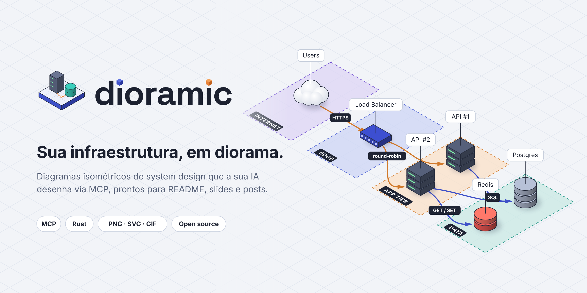
  </picture>
</p>

<p align="center">
  <b>Diagramas isométricos de system design que a sua IA desenha via MCP.</b><br>
  Descreva a arquitetura e receba um PNG, SVG ou GIF animado pronto para README, slides e posts.
</p>

<p align="center">
  
  
  
  
</p>

<p align="center">
  <a href="#começo-rápido">Começo rápido</a> ·
  <a href="#app-desktop">App desktop</a> ·
  <a href="#galeria">Galeria</a> ·
  <a href="#o-formato-diorama">Formato</a> ·
  <a href="#cli">CLI</a> ·
  <a href="#servidor-mcp">MCP</a> ·
  <a href="docs/README.md">Docs de design</a>
</p>

<p align="center">
  <picture>
    <source media="(prefers-color-scheme: dark)" srcset="docs/assets/demo-dark.gif">
    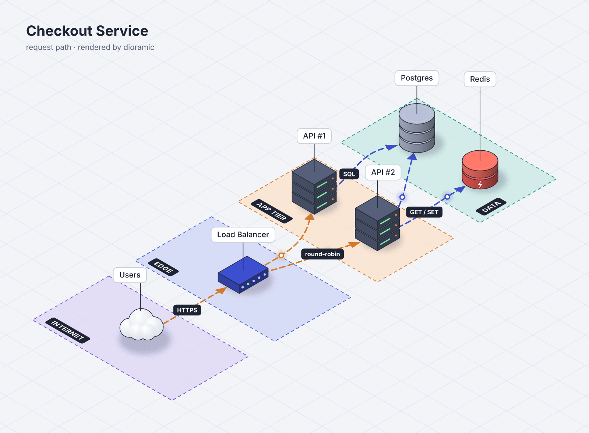
  </picture>
</p>

<p align="center"><sub>Saída real de <code>dioramic render examples/checkout.diorama.yaml -o demo.gif</code>: 1600×1178, 50 fps, loop de 2 s, 835 KB (escuro, <code>--theme midnight</code>: 885 KB). Acompanha o tema claro ou escuro do seu GitHub.</sub></p>

## Por que Dioramic?

Diagramas de arquitetura **bonitos** (isométricos, com cara de maquete) normalmente são feitos à mão em editores visuais.
As ferramentas de *diagram-as-code* que as IAs já dominam geram diagramas **corretos, mas planos**. O Dioramic junta os dois:

- **Bonito por padrão.** Isometria de 30°, sombras suaves, zonas translúcidas e labels que não se atropelam.
- **Feito para IA.** A IA descreve *o quê* (nós, conexões, zonas) e o motor decide *onde*. Ela nunca calcula um pixel.
- **A IA vê o que desenhou.** Cada render devolve uma prévia da imagem e diagnósticos estruturados, para ela se corrigir.
- **Animado.** Pacotes trafegando pelas conexões (`flow`) e montagem passo a passo (`build`), em GIF ou SVG animado.
- **Diagram-as-code.** O diagrama é um arquivo `*.diorama.yaml` versionável; a imagem é só um artefato.
- **Local, um binário.** Rust de ponta a ponta, sem browser headless, sem Python, sem rede.

Inspirado no visual do [Isoflow](https://github.com/markmanx/isoflow) (e do fork FossFLOW) e na praticidade do Mermaid e do `diagrams`.

## Instalação

Binários prontos para macOS (Apple Silicon e Intel), Linux (x86_64 e arm64) e Windows (x64 e arm64; o app desktop é só x64, que roda emulado no arm64) ficam nas
[releases](https://github.com/JonathanSantos/dioramic/releases). O **CLI** (`dioramic`, que inclui o servidor MCP) e o
**app desktop** são baixados separadamente.

CLI + MCP no macOS e Linux (instala em `~/.local/bin`):

```bash
curl -fsSL https://github.com/JonathanSantos/dioramic/releases/latest/download/install.sh | sh
```

CLI + MCP no Windows (PowerShell; instala em `%LOCALAPPDATA%\Programs\dioramic\bin` e ajusta o `PATH`):

```powershell
irm https://github.com/JonathanSantos/dioramic/releases/latest/download/install.ps1 | iex
```

App desktop pelo mesmo instalador (`.app` em `/Applications` no macOS, AppImage em `~/.local/bin` no Linux, instalador `setup.exe` no Windows):

```bash
curl -fsSL https://github.com/JonathanSantos/dioramic/releases/latest/download/install.sh | sh -s -- --desktop
```

```powershell
& ([scriptblock]::Create((irm https://github.com/JonathanSantos/dioramic/releases/latest/download/install.ps1))) -Desktop
```

Os instaladores aceitam `--version v0.1.0`, `--dir <pasta>` e `--dry-run` (no PowerShell: `-Version`, `-InstallDir`, `-DryRun`) e
conferem o SHA-256 de cada download. Pacotes `.dmg`, `.deb`, `.rpm`, `.AppImage`, `.msi` e `.exe` também estão na página da release.

A partir do código-fonte (requer **Rust 1.89 ou mais novo**, edição 2024), na raiz deste repositório:

```bash
cargo install --path crates/dioramic-cli
dioramic --version
```

O binário `dioramic` traz tudo embutido: motor, fontes (Inter), 30 ícones, temas e o servidor MCP. Ícones de provedores são opcionais (`dioramic icons install`).

## Começo rápido

1. **Configure seus clientes de IA** na raiz do seu projeto:

   ```bash
   dioramic init --claude --vscode
   ```

   Grava `.mcp.json` e a skill `.claude/skills/dioramic/SKILL.md` (Claude Code) e `.vscode/mcp.json` (VS Code Copilot).
   Rodar de novo não muda nada; `--dry-run` mostra o diff antes, e entradas de outros servidores e comentários são preservados.
2. **Reinicie o cliente** (ou recarregue a janela do VS Code) para ele subir o `dioramic mcp`.
3. **Peça um diagrama:**

   - *"Desenhe a arquitetura de runtime deste repositório com o dioramic."*
   - *"Anime o caminho de uma requisição de checkout em GIF."*
   - *"Deixe o diagrama compacto e gire para a vista com menos sobreposição."*

   A IA escreve um `diagrams/<nome>.diorama.yaml`, chama `render_diagram`, olha a prévia e ajusta, em geral em até 2 rodadas.

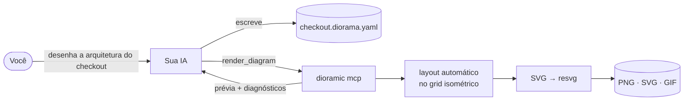

## App desktop

Um app **100% Rust** (Tauri 2 + Leptos) para ver ao vivo o que a IA está desenhando: editor YAML com diagnósticos, prévia que
recarrega a cada gravação, rotação ⟲ ⟳ e `auto`, densidade, conexões em curvas ou trilhos, malha de fundo, tema, prévia em
movimento e exportação em PNG, SVG e GIF.
MCP e app conversam pelo arquivo `*.diorama.yaml`: um escreve, o outro observa.

<p align="center">
  <picture>
    <source media="(prefers-color-scheme: dark)" srcset="docs/assets/desktop-dark.png">
    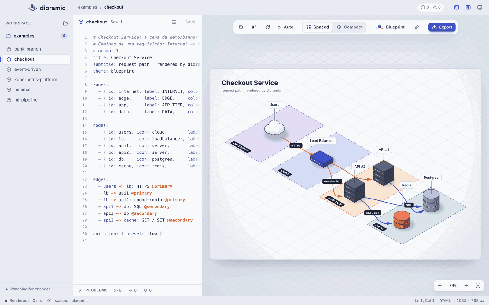
  </picture>
</p>

Para compilar o app você precisa, além do Rust, do [Tauri CLI 2](https://v2.tauri.app/reference/cli/), do [Trunk](https://trunkrs.dev) e do alvo `wasm32-unknown-unknown`:

```bash
cargo install tauri-cli --version "^2" --locked
cargo install trunk --locked
rustup target add wasm32-unknown-unknown
cd apps/desktop && cargo tauri build
```

Durante o desenvolvimento: `cd apps/desktop && DIORAMIC_WORKSPACE=$PWD/../../examples cargo tauri dev`. Detalhes em [docs/08-app-desktop.md](docs/08-app-desktop.md).

## Galeria

Os 8 specs na raiz de [examples/](examples/README.md) também são fixtures de teste (a galeria de system designs fica em [examples/schematic/](examples/schematic/README.md)). Quatro deles, renderizados pelo binário (`--rotate auto`):

<p align="center">
  <picture>
    <source media="(prefers-color-scheme: dark)" srcset="docs/assets/exemplos-dark.png">
    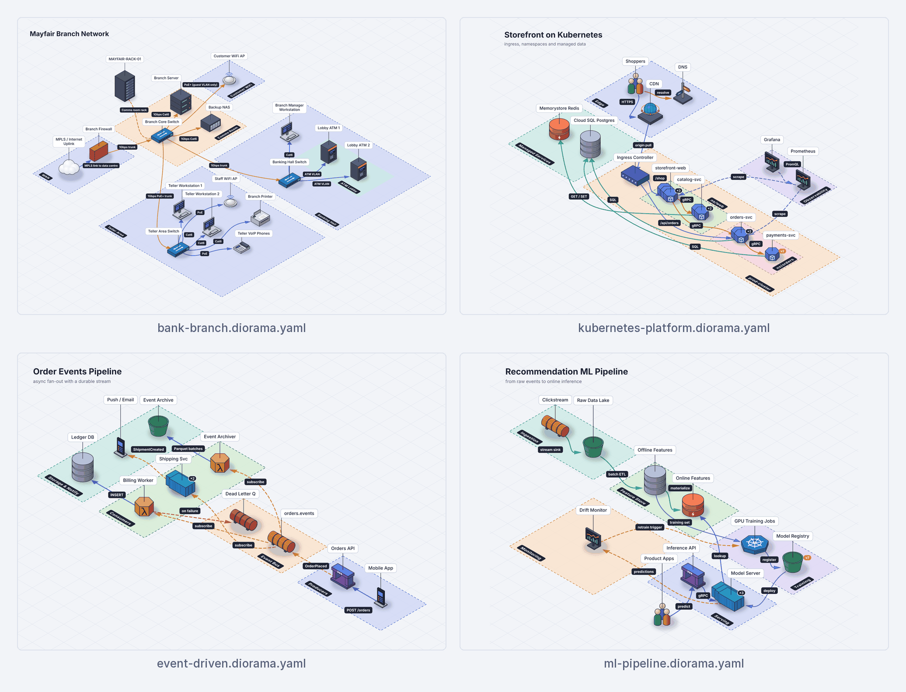
  </picture>
</p>

```bash
dioramic render examples/bank-branch.diorama.yaml -o bank-branch.png --rotate auto
```

## Galeria de system designs

Dez diagramas no tema `schematic`, em ordem de complexidade — do cliente-servidor ao assistente de IA —, cada um com um título curto,
uma linha de subtítulo e conexões coloridas pela classe (cliente, serviço, mensageria, cache, dados, externo, observabilidade).
Nenhum usa coordenadas, rotação ou cores no spec: é o que o motor faz sozinho. Os três últimos são **arquiteturas conceituais**
inspiradas em discussões públicas de system design (estilo WhatsApp, Google Drive e Claude), não o desenho interno dessas empresas.

<p align="center">
  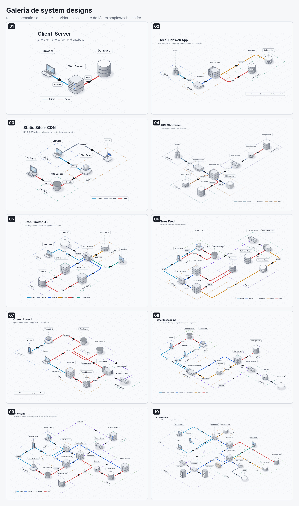
</p>

Specs, miniaturas e o que cada um ensina em [examples/schematic/](examples/schematic/README.md):

```bash
dioramic render examples/schematic/06-news-feed.diorama.yaml -o news-feed.gif
```

## Ícones

30 ícones procedurais em 11 categorias, desenhados pelo próprio motor em qualquer tema e com detalhes (LEDs, portas, logos) sempre na face visível.
A busca aceita sinônimos: `postgres`, `mysql` e `rds` caem em `database`; `lambda` em `function`; `docker` em `container`.

<p align="center">
  <picture>
    <source media="(prefers-color-scheme: dark)" srcset="docs/assets/icones-dark.png">
    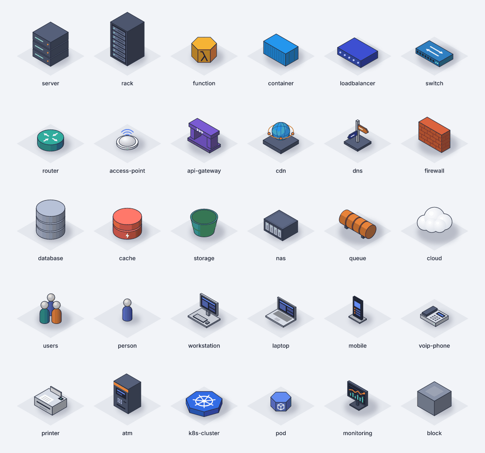
  </picture>
</p>

```bash
dioramic icons list
dioramic icons search postgres
```

### Ícones de AWS, Google Cloud, Azure e Kubernetes

Os ícones oficiais dos provedores entram como `icon: aws/lambda`, `gcp/bigquery`, `azure/functions` ou `k8s/pod` e são desenhados
**planos projetados**: deitados no topo de um bloco isométrico na cor da marca (ou em pé numa placa, `mount: stand`), legíveis nos 4 temas
e nas 4 rotações. O Dioramic **não redistribui** esses arquivos: cada pack é baixado uma vez do site do provedor, sob os termos dele.

```bash
dioramic icons install aws          # pacote oficial (aws.amazon.com/architecture/icons)
dioramic icons install gcp          # cloud.google.com/icons
dioramic icons install azure        # learn.microsoft.com/azure/architecture/icons
dioramic icons install k8s          # github.com/kubernetes/community (Apache-2.0)
dioramic icons install azure --from ~/Downloads/Azure_Public_Service_Icons_V24.zip   # arquivo baixado por você
dioramic icons list --packs         # packs instalados, versão, origem e licença
dioramic icons search "aws lambda"  # busca no catálogo e nos packs
dioramic icons remove gcp
```

Os packs ficam em `$XDG_DATA_HOME/dioramic/icons/<pack>/` (padrão `~/.local/share/dioramic/icons`, inclusive no macOS), com um
`manifest.json` e os SVGs. Sem o pack, o diagrama ainda renderiza com o ícone embutido mais próximo e o aviso `W_ICON_PACK_MISSING`
diz o comando de instalação. Ícones próprios: coloque SVGs em `icons/` ao lado do spec e use `icon: local/<nome-do-arquivo>`.
Exemplo completo em [examples/aws-serverless.diorama.yaml](examples/aws-serverless.diorama.yaml).

## O formato Diorama

O spec da demo acima ([examples/checkout.diorama.yaml](examples/checkout.diorama.yaml)):

```yaml
diorama: 1
title: Checkout Service
subtitle: request path · rendered by dioramic
theme: blueprint

zones:
  - { id: internet, label: INTERNET, color: violet }
  - { id: edge,     label: EDGE,     color: blue }
  - { id: app,      label: APP TIER, color: orange }
  - { id: data,     label: DATA,     color: teal }

nodes:
  - { id: users, icon: cloud,        label: Users,         zone: internet }
  - { id: lb,    icon: loadbalancer, label: Load Balancer, zone: edge }
  - { id: api1,  icon: server,       label: "API #1",      zone: app }
  - { id: api2,  icon: server,       label: "API #2",      zone: app }
  - { id: db,    icon: postgres,     label: Postgres,      zone: data }
  - { id: cache, icon: redis,        label: Redis,         zone: data }

edges:
  - users -> lb: HTTPS @primary
  - lb -> api1 @primary
  - lb -> api2: round-robin @primary
  - api1 -> db: SQL @secondary
  - api2 -> db @secondary
  - api2 -> cache: GET / SET @secondary

animation: { preset: flow }
```

Sem coordenadas e sem cores obrigatórias: o layout é automático, e `at: [x, y]` existe só como dica quando você quiser forçar algo.

| Atalho de aresta | Significado |
|---|---|
| `a -> b` | seta no destino |
| `a <-> b` | seta nos dois lados |
| `a -- b` | linha sem seta |
| `a ..> b` | tracejada com seta (async, dependência lógica) |
| `a -> b: label @estilo` | com label e estilo nomeado |

Specs também podem ser JSON (`*.diorama.json`). Referência completa, regras para a IA e diagnósticos em [docs/04-spec.md](docs/04-spec.md).

## CLI

O mesmo binário serve ao MCP e a você. `dioramic <comando> --help` mostra todas as opções.

| Comando | O que faz |
|---|---|
| `dioramic render <spec>` | Renderiza em PNG, SVG, SVG animado ou GIF (formato pela extensão de `-o` ou por `--format`) |
| `dioramic watch <spec>` | Renderiza de novo a cada gravação (Ctrl+C para sair); erros não derrubam o watcher |
| `dioramic lint <spec>...` | Valida e lista diagnósticos sem rasterizar; `--json` para máquinas; sai com 1 se houver erro `E_*` |
| `dioramic icons list` · `icons search <termo>` | Catálogo de ícones (embutidos + packs instalados) e busca por id, nome, sinônimo, categoria ou `--pack` |
| `dioramic icons install <aws\|gcp\|azure\|k8s>` · `icons remove` · `icons list --packs` | Baixa o pack oficial do provedor (ou lê `--from <zip\|pasta\|url>`), remove e lista os packs |
| `dioramic init` | Configura o MCP e a skill para Claude Code (`--claude`), VS Code Copilot (`--vscode`) e Claude Desktop (`--desktop`); `--global` grava no escopo do usuário |
| `dioramic mcp` | Servidor MCP em stdio (normalmente iniciado pelo cliente de IA) |

```bash
dioramic render examples/checkout.diorama.yaml -o checkout.png
dioramic render examples/checkout.diorama.yaml -o checkout.gif --theme midnight
dioramic render examples/checkout.diorama.yaml -o checkout.svg --density compact --rotate auto
dioramic render examples/checkout.diorama.yaml -f svg-animated -o checkout.anim.svg
dioramic render examples/checkout.diorama.yaml -o checkout-rails.png --routing rails --grid-style dots
dioramic render examples/checkout.diorama.yaml -o checkout-hub.png --layout hub
dioramic watch examples/checkout.diorama.yaml --rotate auto
dioramic lint examples/*.diorama.yaml
```

Opções de `render` e `watch`: `--theme blueprint|midnight|paper|mono|schematic`, `--rotate 0|90|180|270|auto`, `--density spaced|compact`,
`--layout flow|hub`, `--routing curved|orthogonal|straight|rails` (`elbow` = `rails`), `--grid-size <tiles>`, `--grid-style lines|dots|none`, `--grid-opacity <0..1>`,
`--grid-color <token|#hex>`, `--no-icon-animation`, `--scale` (densidade do PNG, padrão 2) e `--width` (largura em px do PNG/GIF;
GIF padrão 1600). Todas valem só para aquele render; o spec não muda.

## Servidor MCP

`dioramic mcp` fala MCP por stdio, sem rede, e só lê e grava dentro das *roots* do cliente (ou do diretório de trabalho).

| Tool | O que faz |
|---|---|
| `render_diagram` | Renderiza um spec (inline ou `spec_path`) em `png`, `svg`, `svg-animated` ou `gif`, com `theme`, `rotation`, `density`, `layout_algorithm`, `routing`, `grid` e `icon_animation` opcionais. Devolve a **prévia** (filmstrip para animações) e um resumo JSON com a vista usada, ângulo escolhido e diagnósticos |
| `validate_diagram` | Valida e faz o layout sem rasterizar (milissegundos); devolve diagnósticos e as posições em tiles, em texto |
| `search_icons` | Busca ícones (embutidos, packs de provedores instalados e `icons/` do projeto) por nome, sinônimo, categoria ou pack, com folha de contato opcional |
| `get_guide` | Guias curtos sob demanda: `quickstart`, `spec`, `styles`, `animation`, `examples`, `icons` |

**Resources:** `dioramic://schema/v1` (JSON Schema do spec), `dioramic://icons/catalog`, `dioramic://guide/{topic}` e `dioramic://examples/{name}`.
**Prompts:** `diagram-from-repo`, `animate-request-flow` e `redraw-image` (no Claude Code viram `/mcp__dioramic__<nome>`).

`dioramic init` faz a configuração por você. À mão:

**Claude Code**

```bash
claude mcp add --scope user --transport stdio dioramic -- dioramic mcp
```

**Claude Desktop** (`claude_desktop_config.json`, ou `dioramic init --desktop`)

```json
{ "mcpServers": { "dioramic": { "command": "dioramic", "args": ["mcp"] } } }
```

**VS Code (GitHub Copilot, modo Agent)** em `.vscode/mcp.json`

```json
{ "servers": { "dioramic": { "type": "stdio", "command": "dioramic", "args": ["mcp"] } } }
```

Se o cliente não mostrar a prévia ao modelo, coloque `"env": { "DIORAMIC_MCP_STRUCTURED": "0" }` na entrada do servidor.
Contratos das tools, limites e segurança em [docs/05-mcp.md](docs/05-mcp.md).

## Rotação e densidade

O mesmo spec visto de **quatro ângulos** e em **duas densidades**, sem mudar uma linha do diagrama:

<p align="center">
  <picture>
    <source media="(prefers-color-scheme: dark)" srcset="docs/assets/rotacao-densidade-dark.png">
    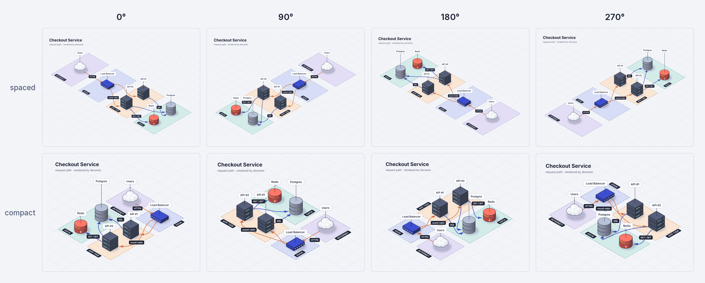
  </picture>
</p>

```yaml
layout: { density: compact }   # spaced (padrão) | compact: zonas dobradas em bloco serpenteando
view:   { rotation: auto }     # 0 | 90 | 180 | 270 | auto: o ângulo com menos sobreposição de labels
```

Na CLI: `--density compact --rotate auto`. As setas sempre terminam numa face visível do componente e apontam para o centro dele,
em qualquer ângulo. Com `auto`, todos os exemplos saem sem sobreposição de labels na densidade espaçada.
A regra completa está em [docs/06-renderizacao.md](docs/06-renderizacao.md#densidade).

## Conexões e malha

Três escolhas, no spec ou só no render: o **layout** (`algorithm: flow`, zonas na ordem do fluxo, ou `hub`, os nós mais conectados
no centro com arestas curtas e alinhadas), os **trilhos isométricos** (`routing: rails`, sinônimo `elbow`: trechos retos nos eixos do
plano, viradas de 90° arredondadas, o mínimo de viradas e chegada alinhada à face do componente) e a **malha de fundo** (linhas, pontos ou nenhuma, no tamanho e na
opacidade que você quiser, sempre presa ao plano do diagrama nas 4 rotações).

<p align="center">
  <picture>
    <source media="(prefers-color-scheme: dark)" srcset="docs/assets/rails-dark.png">
    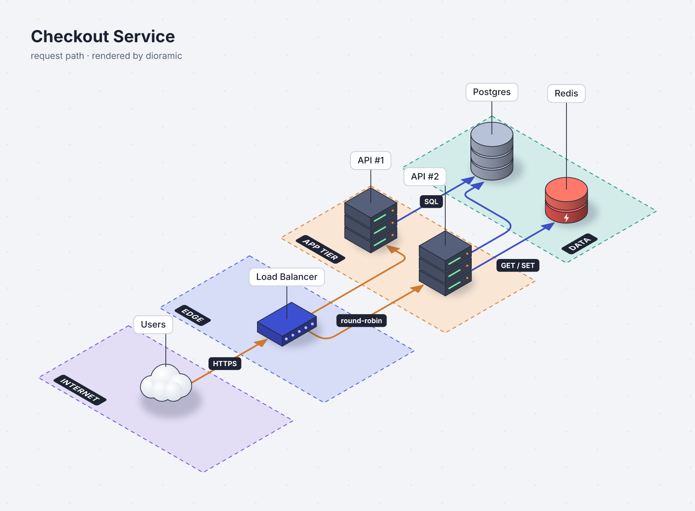
  </picture>
</p>

```yaml
layout: { algorithm: hub, routing: rails }      # algorithm: flow (padrão) | hub · routing: curved (padrão) | orthogonal | straight | rails
view:
  grid: { size: 1, style: dots, opacity: 1 }    # size em tiles (0,25–4) · lines | dots | none · opacity 0–1 · color opcional
```

Na CLI, sem editar o spec: `--layout hub --routing rails --grid-style dots --grid-size 0.5 --grid-opacity 0.6`. No MCP, `render_diagram`
aceita `layout_algorithm`, `routing` e `grid: { size, style, opacity, color }`. No app, **Flow ⟷ Hub** (`L`), **Curves ⟷ Rails** (`R`) e
o popover **Grid** (`G`) ficam na barra flutuante, e o **Fixar** grava `layout.algorithm`, `layout.routing` e `view.grid` no spec. Os trilhos ficam melhores na densidade espaçada; uma aresta com
`route:` próprio mantém a sua.

## Animação

| Preset | O que acontece |
|---|---|
| `flow` | Tráfego contínuo: tracejado andando e pacotes nas conexões (a demo acima), em loop |
| `build` | Montagem: zonas surgem, nós "caem" no lugar, conexões se desenham, labels aparecem |
| `story`, `pulse` | Planejados; na v1 caem no `flow` |

| Formato | Para quê |
|---|---|
| **PNG** | Docs, slides e qualquer lugar (padrão @2x) |
| **SVG** | Vetorial; o texto sai em contornos, então fica idêntico em qualquer máquina |
| **GIF** | README, Slack, PRs. 1600 px a 50 fps com paleta global e frames delta, menos de 1 MB na demo ([como medimos](docs/07-animacao.md#gif-de-alta-qualidade-e-fluido-medido)) |
| **SVG animado** | O mais leve (cerca de 100 KB na demo) e nítido; anima nativamente no browser |

Nos formatos animados os **ícones também se movem**, de leve e em loop perfeito com os pacotes: LEDs do servidor piscando em sequência,
ondas do access point, anel no banco e no cache, mensagens andando na fila, hélice do Kubernetes girando devagar.
`animation: { icons: false }` (ou `--no-icon-animation` na CLI, `icon_animation: false` no MCP) deixa só o tráfego andando.
No app, o botão **Motion** (`M`) toca a prévia animada; ele fica desligado quando o sistema pede para reduzir movimento.

<p align="center">
  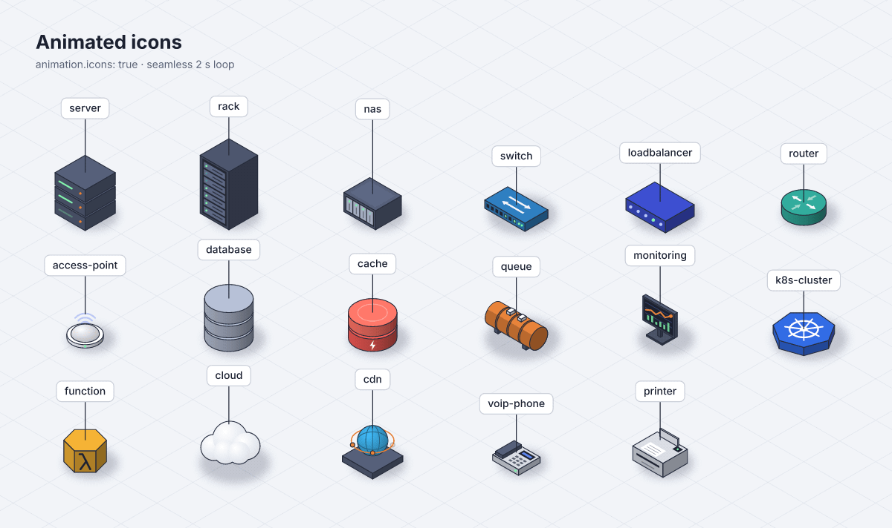
</p>

APNG, WebP e MP4/WebM estão no plano. Detalhes em [docs/07-animacao.md](docs/07-animacao.md).

## Temas

`blueprint` (claro, padrão), `midnight` (escuro), `paper` (off-white, pastel), `mono` (tons de cinza, para impressão) e
`schematic` (desenho técnico para system design de alto nível: layout `hub` com os nós mais conectados no centro, ícones prateados,
conexões grossas em trilhos com a seta no meio e **cores por classe de conexão** — dados, cache, mensageria, externo, cliente,
serviço — com legenda automática). No `schematic` o spec não precisa de `wrap`, `rotation` nem `at`: a espinha clientes → borda →
serviços → dados sai legível com os padrões.
Use `theme:` no spec ou `--theme` na CLI. As demais imagens deste README existem em `blueprint` e `midnight`.

<p align="center">
  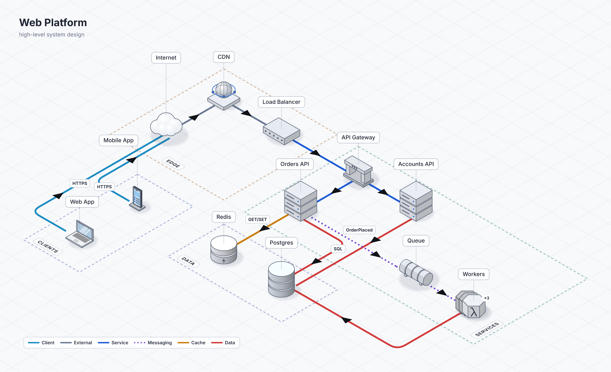
</p>
<p align="center"><sub>Saída real de <code>dioramic render examples/web-platform.diorama.yaml</code> (<code>theme: schematic</code>, layout <code>hub</code> e trilhos por padrão; as cores vêm das classes inferidas, sem nenhum estilo, <code>wrap</code> ou rotação no spec).</sub></p>

## Desenvolvimento

```
crates/
├── dioramic-spec     # formato Diorama: parse JSON/YAML, atalhos, normalização, validação, diagnósticos
├── dioramic-core     # layout, rotação/densidade, ícones, temas, cena, setas, colisão de labels, SVG, animação
├── dioramic-render   # fontes embutidas, resvg, PNG, GIF, filmstrip, prévia
├── dioramic-mcp      # servidor MCP (rmcp, stdio)
├── dioramic-packs    # packs de ícones em disco: manifest, instalação a partir dos pacotes oficiais, ícones do projeto
├── dioramic-cli      # binário `dioramic`
└── test-support      # fixtures, asserts visuais, snapshots
xtask                 # galeria visual, golden files, modo QA rápido
apps/desktop          # app Tauri 2 + Leptos (workspace próprio)
examples              # specs de exemplo (também fixtures)
```

```bash
cargo xtask qa dioramic-core               # fmt + clippy -D warnings + testes de um crate (ou `all`)
cargo xtask gallery --filter checkout      # exemplos × temas × rotações × densidades em target/gallery/, com folhas de contato
cargo xtask golden                         # compara os golden files; --update regenera depois de mudança visual intencional
cargo test --workspace
```

O projeto é construído por vários agentes em paralelo, com um processo leve: quadro, tarefas, contratos entre crates e revisões
em [docs/work/](docs/work/README.md), e os papéis (orquestrador, refiner, implementer, QA, UI reviewer) em [.claude/agents/](.claude/agents/).
Regras de código e idioma em [CLAUDE.md](CLAUDE.md); decisões e justificativas nos [ADRs](docs/02-decisoes.md).

Contribuições são bem-vindas: abra uma issue comentando o [formato](docs/04-spec.md), as [tools MCP](docs/05-mcp.md) ou o
[roadmap](docs/09-roadmap.md). Exemplos reais de arquitetura que você gostaria de desenhar viram casos de teste.

## Próximos passos

- Pack isométrico do Isoflow (os ícones de AWS, GCP, Azure e Kubernetes já entraram como planos projetados)
- Presets `story` e `pulse`; APNG, WebP e MP4/WebM
- Roteamento ortogonal de arestas e modo editor no app (arrastar nós)
- Binários prontos e Homebrew; import/export do Isoflow/FossFLOW

Critérios e riscos em [docs/09-roadmap.md](docs/09-roadmap.md).

## Licença e créditos

Licenciado, à sua escolha, sob a [Apache License 2.0](LICENSE-APACHE) ou a [licença MIT](LICENSE-MIT).

Salvo declaração explícita em contrário, qualquer contribuição enviada intencionalmente para inclusão no Dioramic,
conforme definido na licença Apache-2.0, será licenciada duplamente como acima, sem termos ou condições adicionais.

**Créditos:** estética inspirada no [Isoflow](https://github.com/markmanx/isoflow) (MIT, © Mark Mankarious) · renderização por [resvg](https://github.com/linebender/resvg) ·
MCP com [rmcp](https://github.com/modelcontextprotocol/rust-sdk) · app com [Tauri](https://tauri.app) e [Leptos](https://leptos.dev) ·
fontes [Inter](https://rsms.me/inter/) e [Space Grotesk](https://github.com/floriankarsten/space-grotesk) (SIL OFL).
O nome e o logo do Dioramic identificam este projeto; forks devem usar outro nome. Guia de marca em [docs/10-marca.md](docs/10-marca.md).
