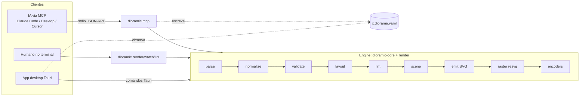

# 03 — Arquitetura

## Visão geral



## Workspace Cargo

```
dioramic/
├── Cargo.toml                 # workspace raiz (8 membros); exclui apps/
├── crates/
│   ├── dioramic-spec/         # tipos do spec (serde + schemars), parse JSON/YAML, atalhos, normalização, validação, diagnósticos
│   ├── dioramic-core/         # layout, ícones (`icons`), temas, cena, setas/portas, colisão, lint, SVG, texto, animação
│   │                          #   → sem I/O e sem dependências nativas (compila para wasm32, mas na v1 só roda nativo)
│   ├── dioramic-render/       # fontdb, resvg, encoders (png, gif), filmstrip, prévia, fachada `Engine`
│   ├── dioramic-packs/        # packs de ícones de marca em disco (AWS, GCP, Azure, K8s) e `icons/` do projeto:
│   │                          #   manifest, instalação a partir das fontes oficiais, carga do `IconRegistry`
│   ├── dioramic-mcp/          # servidor rmcp (stdio): tools, resources, prompts, instruções
│   ├── dioramic-cli/          # binário `dioramic` (clap): render | watch | lint | icons | mcp | init
│   └── test-support/          # fixtures, asserts visuais (colisão, setas), golden files, métricas de qualidade
├── xtask/                     # mini engine de dev: `cargo xtask qa | gallery | golden`
├── apps/desktop/              # workspace Cargo **separado** (Tauri 2 + Leptos), ver doc 08
│   ├── ipc/                   #   DTOs serde backend ↔ UI (sem depender do engine)
│   ├── src-tauri/             #   backend: comandos Tauri sobre `dioramic_render::Engine` (+ packs de ícones)
│   └── ui/                    #   frontend Leptos CSR (wasm, via trunk)
├── assets/fonts/              # Inter e Space Grotesk (OFL), embutidas
├── examples/*.diorama.yaml    # exemplos (também são fixtures de teste e resources do MCP)
├── tests/golden/              # PNG/SVG de referência para regressão visual
└── docs/
```

O catálogo, a busca e o desenho dos ícones ficam em `dioramic-core::icons` (contrato [C-003](work/contracts/C-003-icons.md)):
os 30 procedurais e os ícones **planos projetados** de packs de marca ([ADR-006](02-decisoes.md#adr-006)), recebidos já carregados num
`IconRegistry` (o core não faz I/O). Quem lê disco é o `dioramic-packs`: a store `$XDG_DATA_HOME/dioramic/icons/<pack>/` (senão
`~/.local/share/dioramic/icons`, também no macOS) com `manifest.json`, a instalação pelo CLI a partir das fontes oficiais
([ADR-007](02-decisoes.md#adr-007)) e a pasta `icons/` ao lado do spec (`local/<nome>`). CLI, MCP e desktop montam o registro com ele e o
passam em `RenderRequest.icons`; MCP e desktop o mantêm em cache e só o releem quando a store ou a pasta `icons/` mudam.

Dependências entre crates: `spec` ← `core` ← `render` ← {`mcp`, `cli`, `xtask`, desktop}; `core` ← `packs` ← {`mcp`, `cli`, desktop};
`test-support` usa `core` e `render`.
O app desktop depende de `dioramic-spec`, `dioramic-render`, `dioramic-core` (o tipo `IconRegistry`) e `dioramic-packs` por caminho e chama o
`Engine` **no backend**, via comandos Tauri; a UI recebe SVG pronto e não carrega o core. O backend vigia a store de packs (a cada 2 s, só
metadados) e as pastas `icons/` do workspace (pelo watcher de arquivos) e pede um novo preview quando algo muda.

### Dependências principais (versões verificadas em out/2026)

| Área | Crate | Versão | Licença |
|---|---|---|---|
| MCP | `rmcp` | 3.5 | Apache-2.0 |
| Async | `tokio` | 1.53 | MIT |
| Schema | `serde`, `schemars` | 1.x / 1.2 | MIT/Apache |
| YAML | `serde-saphyr` | 1.3 | MIT/Apache |
| SVG → raster | `usvg`, `resvg`, `tiny-skia` | 0.48 / 0.48 / 0.12 | MIT/Apache, BSD-3 |
| Fontes | `fontdb`, `rustybuzz` | 0.24 / 0.20 | MIT |
| PNG | `png` | 0.18 | MIT/Apache |
| GIF | `gif` + `quantette` | 0.14 / 0.6 | MIT/Apache |
| Paralelismo | `rayon` | 1.12 | MIT/Apache |
| Sugestões "você quis dizer" | `strsim` | 0.11 | MIT |
| Watch de arquivos | `notify` | 8.2 | CC0 |
| CLI | `clap` | 4.6 | MIT/Apache |
| Testes | `insta`, `image-compare` | 1.49 / 0.5 | Apache / MIT |
| Desktop | `tauri`, `leptos` | 2.12 / 0.8 | MIT/Apache |

Ranks do layout são calculados à mão (sem `petgraph`). APNG, WebP e MP4 não estão na v1: o MCP responde "not supported yet".

## Pipeline e tipos

Cada etapa é uma função pura com tipos explícitos, o que permite testar e cachear cada uma isoladamente.

| # | Etapa | Onde | Entrada → Saída | Notas |
|---|---|---|---|---|
| 1 | **parse** | `dioramic-spec` | `&str` (JSON/YAML) → `SpecV1` | Erros com linha e coluna |
| 2 | **normalize** | `dioramic-spec` | `SpecV1` → `Model` | Expande atalhos (`"a -> b: x"`), aplica defaults (ex.: rotação `auto` no compacto) |
| 3 | **validate** | `dioramic-spec` + `core::icons` | `Model` → `Diagnostics` | Ids duplicados, refs quebradas, ícone inexistente. **Erros interrompem** |
| 4 | **layout** | `core::layout` | `Model` + `Density` → `PlanLayout` | Zonas e nós no **plano** (tiles), rotação 0 |
| 5 | **scene** | `core::scene` | `PlanLayout` + tema + rotação → `Scene` | Rotação, portas e rotas das arestas, colisão de labels, lint (`W_*`, só avisos), `viewBox`; `auto` monta os 4 ângulos |
| 6 | **emit** | `core::svg` | `Scene` (+ `AnimationPlan`) → SVG | Estático, `Frame{t}` com `t ∈ [0,1)` ou animado (CSS + SMIL) |
| 7 | **raster** | `dioramic-render` | SVG → `Pixmap` | `resvg`, com `fontdb` compartilhado |
| 8 | **encode** | `dioramic-render` | `Pixmap`(s) → PNG/GIF | Frames renderizados em paralelo com `rayon` |
| 9 | **preview** | `dioramic-render` | saída → PNG reduzido ou filmstrip | É o que volta para a IA no MCP |

Os tipos reais e as assinaturas estão nos contratos ([C-001](work/contracts/C-001-spec-model-diagnostics.md) a
[C-006](work/contracts/C-006-render-engine.md)); `Engine::render` (C-006) é a fachada única usada por MCP, CLI e desktop.

> A cena é montada **no plano** e só projetada para a tela no final. Qualquer algoritmo de layout 2D funciona,
> porque a isometria é apenas uma transformação afim do plano (ver [06](06-renderizacao.md)).

## Desempenho

Medido na v1 (Mac arm64, release, QA da rodada 1; o spike em Node + resvg-js serviu de meta):

| Operação | Spike | v1 (Rust) | Meta v1 |
|---|---|---|---|
| PNG @2x do checkout (≈ 2170×1526) | 130 ms | 107–119 ms | < 300 ms |
| GIF 1600 px, 100 frames | — | < 3 s (render + encode) | — |
| `rotation: auto` (4 cenas, bank-branch) | 3–6 ms | ≈ 20 ms | < 20 ms |

Os tempos são sensíveis à carga da máquina; meça com ela ociosa (`--test-threads=1`).

Regras:

- `fontdb::Database` fica em cache **por processo** (o servidor MCP é longo, então o custo é pago uma vez).
- Fazer o parse do SVG a cada frame é barato. Se virar gargalo, gerar a árvore `usvg::Tree` direto da `Scene`, sem passar por string.
- **Cache de saída:** `hash(spec normalizado + opções + versão do renderer)` → se já existe, devolve sem renderizar.

## Determinismo

- Nada de `HashMap` em caminhos que afetam ordem de saída: usar `IndexMap`/`BTreeMap` e ordenações estáveis.
- Floats formatados com precisão fixa no SVG (1 casa decimal basta para tela).
- Fontes embutidas, nunca do sistema ([ADR-008](02-decisoes.md#adr-008)).
- Ids de `<defs>` (degradês, marcadores) derivados do conteúdo, não de contadores globais.
- Versão do renderer gravada no SVG (`<metadata>`) para rastrear diferenças.

## Testes

| Tipo | Ferramenta | O que garante |
|---|---|---|
| Snapshot de SVG | `insta` | Diff legível de qualquer mudança visual |
| Golden SVG/PNG | `test-support::golden` (`image-compare` com tolerância), `cargo xtask golden [--update]` | Regressão de raster (fontes, anti-alias); arquivos em `tests/golden/` |
| Asserts visuais | `test-support` (`assert_no_collisions`, `assert_arrows_aim_at_targets`, `SceneQuality`) | Setas < 1° e visíveis, colisão zero onde exigido, arestas através de nós |
| Galeria | `cargo xtask gallery` | Todos os exemplos × temas × rotações × densidades, folha de contato e `report.json` com métricas |
| Propriedade | `proptest` | O layout **nunca** sobrepõe footprints nem zonas irmãs para specs aleatórios válidos |
| Contrato MCP | testes de integração com cliente `rmcp` no mesmo processo | Schemas das tools e mensagens de erro estáveis |
| "Eval de IA" | script que pede N diagramas a um modelo | Taxa de sucesso em ≤ 2 iterações (critério do [01](01-visao.md)) |

## Onde os arquivos vão

- Se a chamada informa `spec_path`, a saída vai ao lado: `rede.diorama.yaml` → `rede.png`.
- Se o spec vem inline, grava em `./diagrams/<slug-do-título>.<ext>` na primeira *root* do cliente MCP (ou no diretório de trabalho; cwd `/` cai para `$HOME`).
- O servidor **só lê e escreve dentro das roots** (ou do diretório de trabalho). Nunca fora delas; symlinks para fora são recusados ([05](05-mcp.md#segurança)).
