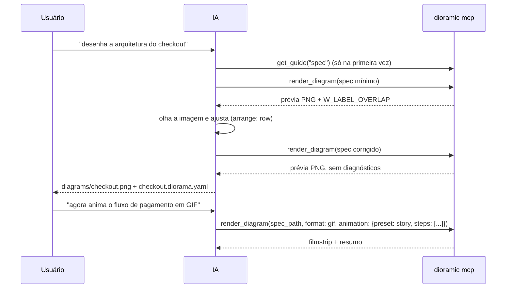

# 05 — Servidor MCP

## Princípios

- **Poucas tools, schemas ricos.** Cada tool extra custa contexto em toda conversa e aumenta a chance da IA escolher errado.
- **O render devolve a imagem.** O modelo *vê* o resultado e se corrige. Esse é o diferencial em relação a servidores que só devolvem um caminho de arquivo.
- **Diagnósticos estruturados além da imagem.** Mesmo um modelo sem visão consegue corrigir sobreposições pelos códigos `W_*`.
- **Nomes e descrições das tools em inglês** (é o que os modelos mais viram em treino); a documentação humana fica em português.
- **Transporte stdio**, local, sem rede. HTTP (streamable) só se o app desktop precisar no futuro.

## Tools (v1)

Implementado em `crates/dioramic-mcp` (`rmcp` 3.5, stdio). As 4 tools têm anotações; cada descrição tem ≤ ~900 caracteres e cita
"diagram" (ajuda o *tool search* do Claude Code). Nenhuma tool declara `outputSchema`, para o cliente não validar resultados de erro.

### 1. `render_diagram`

Renderiza um spec e grava a saída. É a tool principal.

| Parâmetro | Tipo | Default | Descrição |
|---|---|---|---|
| `spec` | DioramaSpec (objeto) | — | Spec inline. **Ou** `spec`, **ou** `spec_path` |
| `spec_path` | string | — | Caminho de um `.diorama.yaml` ou `.diorama.json` |
| `format` | `png` \| `svg` \| `gif` \| `svg-animated` | `png` | `apng`, `webp`, `mp4`, `webm` são aceitos no schema mas respondem `isError` "not supported yet" |
| `output_path` | string | ao lado do spec ou `./diagrams/<slug>.<ext>` | Se for diretório, vira `<dir>/<slug>.<ext>`. Sempre dentro das roots |
| `save_spec` | bool | `true` | Com spec inline, grava `<stem>.diorama.yaml` ao lado da saída (JSON inline é convertido para YAML). Assim o humano e o app desktop conseguem abrir |
| `scale` | 1–4 | 2 | Densidade do PNG (fora da faixa → `isError`) |
| `theme` | string | do spec | Sobrescreve o tema |
| `rotation` | `0` \| `90` \| `180` \| `270` \| `auto` | do spec | Gira a câmera. `auto` escolhe o ângulo com menos colisões e informa qual foi no resumo |
| `density` | `spaced` \| `compact` | do spec | Diagrama espaçado (padrão) ou compacto |
| `layout_algorithm` | `flow` \| `hub` | do spec (`hub` no tema `schematic`, `flow` nos outros) | Sobrescreve `layout.algorithm`: `hub` põe os nós mais conectados no centro, com arestas curtas e alinhadas |
| `routing` | `curved` \| `orthogonal` \| `straight` \| `rails` (sinônimo `elbow`) | do spec (`rails` no `schematic`) | Sobrescreve `layout.routing`. `rails` = cotovelos isométricos (retas nos eixos, viradas de 90° arredondadas, o mínimo de viradas). Arestas com `route` próprio mantêm o seu |
| `grid` | `{ size, style, opacity, color }` | do spec | Sobrescreve `view.grid` campo a campo: `size` em tiles (0,25–4), `style` `lines` \| `dots` \| `none`, `opacity` 0–1, `color` token ou hex. Valor fora da faixa → `E_BAD_VALUE` (`isError`) |
| `icon_animation` | bool | do spec (`true`) | `gif`/`svg-animated`: `false` deixa os ícones parados (LEDs, ondas, anéis) e só o tráfego anda (`animation.icons`) |
| `animation` | objeto | do spec | Sobrescreve `preset`, `duration`, `fps` (ver doc 07) |
| `preview` | `image` \| `none` | `image` | Devolver ou não a prévia para o modelo |

**Retorno:** `content = [image/png, text(JSON)]` e `structuredContent` com o **mesmo** JSON. `DIORAMIC_MCP_STRUCTURED=0` (no `env` do servidor)
desliga o `structuredContent`, para clientes antigos que deixam de mostrar a imagem quando ele está presente.

1. **Imagem de prévia** em PNG com no máximo 1024 px no maior lado (cerca de 1k tokens de imagem).
   Para formatos animados, um **filmstrip** com 4 quadros-chave lado a lado, porque o modelo não vê GIF animado.
   O filmstrip foi validado no spike.
2. **Resumo** em JSON:

```json
{
  "output_path": "diagrams/checkout-service.gif",
  "spec_path": "diagrams/checkout-service.diorama.yaml",
  "format": "gif", "width": 1600, "height": 1125, "bytes": 976678,
  "frames": 100, "duration_ms": 2000,
  "view": { "rotation": 180, "density": "compact", "theme": "blueprint", "layout_algorithm": "flow", "routing": "rails",
            "grid": { "size": 1.0, "style": "dots", "opacity": 1.0, "color": null }, "icon_animation": true,
            "rotation_scores": { "0": 3187, "90": 2291, "180": 1060, "270": 2832 } },
  "diagnostics": [
    { "code": "W_EDGE_THROUGH_NODE", "severity": "warning", "path": "edges[4]",
      "message": "edge api2->db passes over node 'cache'",
      "hint": "move 'cache' with zone arrange: column, or set route: orthogonal" }
  ],
  "preview": "filmstrip"
}
```

Caminhos são relativos à primeira root. `frames`/`duration_ms` só em formatos animados; `preview` é `image` ou `filmstrip`.
`view` ecoa a vista **usada** (já com os overrides e os defaults do tema): `layout_algorithm`, `routing`, `grid` com os defaults preenchidos e
`icon_animation` (só em formatos animados).

Tudo que a IA pode corrigir volta como **`isError: true`** (nunca erro JSON-RPC): diagnósticos `E_*`, parâmetros inconsistentes, caminho fora da root,
formato não suportado, falha do engine. O texto traz a lista legível e o JSON `{error, diagnostics}`. Nada é gravado quando há erro.
JSON-RPC só para resource inexistente.

### 2. `validate_diagram`

Mesmos parâmetros de entrada de `spec`/`spec_path` (mais `theme`, `rotation`, `density`, `layout_algorithm` e `routing`), **sem rasterizar** (alguns ms). Retorna:

- diagnósticos (erros e avisos de lint);
- **resumo do layout em texto**: vista, cantos de cada zona e centro de cada nó em tiles (com o ícone resolvido), para a IA raciocinar sobre o espaço sem precisar de imagem.

O mesmo resumo vai em `structuredContent`.

### 3. `search_icons`

| Parâmetro | Tipo | Default |
|---|---|---|
| `query` | string | — (ex.: `"postgres"`, `"message queue"`, `"nas"`, `"aws lambda"`); vazia lista o catálogo |
| `category` | string | — (`compute`, `network`, `security`, `data`, `messaging`, `cloud`, `clients`, `devices`, `k8s`, `observability`, `generic`); desconhecida → `isError` listando as válidas |
| `pack` | string | — (`builtin`, `aws`, `gcp`, `azure`, `k8s`, `local`); pack não instalado → `hint` com `dioramic icons install <pack>` |
| `limit` | int | 12 (máx. 100) |
| `preview` | bool | `false`; quando `true`, devolve também uma **folha de contato** (grid de ícones com os ids) |

Retorna `{ icons: [{ id, name, aliases, category, kind, pack? }], packs: [{ id, name, installed, install? }] }`: a busca cobre o catálogo
embutido (`kind: procedural`), os **packs de provedores instalados** e os **ícones do projeto** (`kind: flat`, com `pack`); `packs` diz quais
packs de provedor existem e o comando para instalar os que faltam. Sem resultado vem um `hint`.

O render e o `validate_diagram` enxergam o mesmo registro: packs instalados (`$XDG_DATA_HOME/dioramic/icons`, relidos só quando mudam,
então um `dioramic icons install` vale sem reiniciar o servidor) + `icons/` na pasta do spec. Pack ausente → aviso `W_ICON_PACK_MISSING`
com o ícone embutido mais próximo no lugar; a IA deve repassar o comando ao usuário em vez de tentar outro ícone em loop.

### 4. `get_guide`

`topic`: `quickstart` | `spec` | `styles` | `animation` | `examples` | `icons`. Retorna markdown curto e direto (em inglês, < 6 000 caracteres,
embutido no binário), derivado destes docs. É a "documentação sob demanda" que o modelo consulta em vez de carregar tudo no contexto.

### Candidatas para depois

| Tool | Quando |
|---|---|
| `open_in_app` | Quando o app desktop existir: abre o spec no app (deep link `dioramic://open?path=…`) |
| `export_isoflow` / `import_isoflow` | Ponte com o FossFLOW para edição manual no navegador |
| `patch_diagram` | Só se specs grandes ficarem caros de reenviar inline. Em clientes com ferramentas de arquivo (Claude Code), a IA já edita o `.diorama.yaml` direto e chama `render_diagram(spec_path)` |

## Instruções do servidor

O campo `instructions` do `initialize` é injetado no contexto pelos clientes. Ele é curto (≈ 1 160 caracteres; teste falha acima de 2 000):

```text
dioramic draws beautiful isometric architecture diagrams from a small declarative spec (DioramaSpec).
Workflow: (1) write a minimal spec — nodes, edges, optional zones; NO coordinates or colors at first;
(2) call render_diagram; (3) look at the returned preview image and diagnostics; fix and re-render (max 3 rounds).
Call get_guide("spec") the first time; call search_icons before using an icon you are not sure exists.
Edges shorthand: "a -> b: label @style". Prefer spec_path when you can edit files.
If the diagram is too long or sparse, set layout.density: compact; if labels or arrows are hidden, set view.rotation: auto.
For a high-level system design, use theme: schematic (hub layout, rails, edges colored by kind, legend) and leave wrap,
rotation and at out. Tangled edges: layout.algorithm: hub. Engineering look: layout.routing: rails (alias elbow).
Edge colors: layout.edge_colors semantic | style | mono; legend: view.legend auto | on | off.
GIF / animated SVG icons move a little (LEDs, waves); animation.icons: false keeps them still.
Outputs are written only inside the project (client roots or working directory), by default in ./diagrams/.
```

## Resources e prompts

**Resources** (somente leitura, embutidos no binário):

| URI | MIME | Conteúdo |
|---|---|---|
| `dioramic://schema/v1` | `application/json` | JSON Schema do `SpecV1` |
| `dioramic://icons/catalog` | `application/json` | Os 30 ícones embutidos (`id`, `name`, `aliases`, `category`, `kind`); ícones de packs instalados aparecem no `search_icons` |
| `dioramic://guide/{topic}` (template) | `text/markdown` | Os mesmos 6 guias do `get_guide` |
| `dioramic://examples/{name}` (template) | `application/yaml` | Os 6 specs de `examples/` |

**Prompts** (no Claude Code viram `/mcp__dioramic__<nome>`; no VS Code, `/dioramic.<nome>`):

| Prompt | Argumentos | Pede à IA |
|---|---|---|
| `diagram-from-repo` | `focus` (opcional) | Analisar o repositório e desenhar a arquitetura de runtime |
| `animate-request-flow` | `request`, `spec_path` (opcionais) | Animar o caminho de uma requisição passo a passo |
| `redraw-image` | `notes` (opcional) | Recriar o diagrama da imagem anexada como DioramaSpec |

## Loop de feedback



## Implementação

| Módulo | Papel |
|---|---|
| `server.rs` | `DioramicServer`: engine, routers de tools e prompts, resources, `get_info` com as instruções, roots do cliente |
| `params.rs` | Schemas `schemars`. `spec` chega como JSON cru, mas é **declarado** com o schema do `SpecV1`: spec malformado vira `E_PARSE`/`E_*` com `isError`, não erro de protocolo |
| `render_tool.rs`, `validate_tool.rs`, `icons_tool.rs` | As tools; render e escrita rodam em `spawn_blocking` |
| `workspace.rs` | Segurança de caminhos (abaixo) |
| `outcome.rs` | `ToolError` → `CallToolResult` com `isError`; pânico do engine vira "internal error" em vez de derrubar o servidor |

## Segurança

- Lê (`spec_path`) e escreve **apenas** dentro das *roots* `file://` do cliente (consultadas só se ele anuncia a capacidade, timeout de 5 s)
  ou do diretório de trabalho; cwd `/` (apps GUI como o Claude Desktop) cai para `$HOME`. Normalização léxica + canonicalização do maior
  prefixo existente, o que pega symlink para fora. Caminho fora → `isError`.
- Nenhum acesso à rede. Packs de ícones de provedores, quando existirem, serão instalados pelo CLI, nunca pelo MCP.
- Limites contra specs abusivos: `spec_path` até 1 MiB, até 500 nós, até 600 frames e até 8192 px por lado.

## Clientes prioritários

Os três clientes-alvo, nesta ordem: **Claude Code**, **Claude Desktop** e **VS Code (GitHub Copilot, modo Agent)**.

| Recurso do MCP | Claude Code | Claude Desktop | VS Code Copilot |
|---|---|---|---|
| Tools | ✅ | ✅ | ✅ (só no modo **Agent**) |
| Imagem no resultado da tool (prévia) | ✅ | ✅ | ✅ desde a v1.100, mas **depende do modelo**: há relatos de modelos que não "veem" a imagem |
| Prompts (viram comandos) | ✅ slash commands | ✅ | ✅ |
| Editar `spec_path` direto | ✅ (tem ferramentas de arquivo) | ⚠️ não edita arquivos; usa spec inline | ✅ |

Consequências para o design:

- **Diagnósticos em texto são obrigatórios**, não só a imagem: garantem o loop de correção mesmo quando o modelo não enxerga a prévia (VS Code com alguns modelos).
- **Spec inline continua de primeira classe**, por causa do Claude Desktop. `save_spec: true` grava o arquivo para o humano e o app desktop.
- **Formatos de configuração diferentes:** o VS Code usa a chave `servers` e exige `"type": "stdio"`; os clientes Claude usam `mcpServers`.

## Configuração nos clientes

**Claude Code** (escopo do usuário):

```bash
claude mcp add --scope user --transport stdio dioramic -- dioramic mcp
```

Ou, para todos os clientes de uma vez, `dioramic init` (projeto) / `dioramic init --global` (usuário): grava as configurações abaixo
preservando comentários do JSONC e instala a skill `dioramic`; `--dry-run` mostra o diff antes.

**Claude Desktop** (`claude_desktop_config.json`):

```json
{ "mcpServers": { "dioramic": { "command": "dioramic", "args": ["mcp"] } } }
```

**VS Code (Copilot)**, por projeto em `.vscode/mcp.json` (ou no perfil do usuário pelo comando *MCP: Add Server*):

```json
{ "servers": { "dioramic": { "type": "stdio", "command": "dioramic", "args": ["mcp"] } } }
```

Os testes automáticos sobem cliente e servidor `rmcp` no mesmo processo. Falta o teste de fumaça **manual** por cliente (humano): instalar,
pedir um diagrama, conferir se a prévia chega ao modelo e se os diagnósticos aparecem; se a prévia não chegar, repetir com `DIORAMIC_MCP_STRUCTURED=0`.
