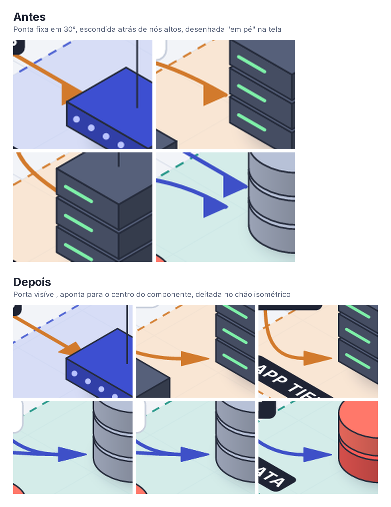

# 06 — Renderização isométrica

Todo o raciocínio de layout acontece no **plano** (tiles). A isometria é só a última transformação.
Implementação de referência da matemática: [spike/spike-resvg.mjs](spike/spike-resvg.mjs) (descartável, porta 1:1 para Rust).

## Projeção

Para um ponto no plano `(x, y)` em tiles, com altura `z`, e tile de `T` px:

```
X = (x − y) · cos30° · T
Y = (x + y) · sin30° · T  −  z · T
```

`cos30° ≈ 0,866` e `sin30° = 0,5`. A inclinação das linhas do grid é `tan30° ≈ 0,577`, a mesma medida na referência.

### Matrizes afins (SVG `transform="matrix(a,b,c,d,e,f)"`)

Servem para "deitar" ou "encostar" qualquer conteúdo 2D (texto, ícone plano) numa face:

| Plano | Matriz | Uso |
|---|---|---|
| **Chão** (`z` constante) | `matrix(0.866, 0.5, -0.866, 0.5, X, Y)` | Zonas, labels de zona deitados, ícones planos no topo de blocos |
| **Face esquerda** (`y` constante, voltada para +y) | `matrix(0.866, 0.5, 0, 1, X, Y)` | Texto ou logo na frente de uma caixa |
| **Face direita** (`x` constante, voltada para +x) | `matrix(0.866, -0.5, 0, 1, X, Y)` | Idem, na lateral direita |

### Círculos

Um círculo de raio `r` no plano vira uma elipse com `rx = √2·cos30°·r·T ≈ 1,225·r·T` e `ry = √2·sin30°·r·T ≈ 0,707·r·T`
(`ry/rx = tan30°`). É a base de cilindros (bancos de dados), sombras e nuvens.

## Ordem de pintura

O algoritmo do pintor, em camadas fixas:

1. fundo → 2. grid → 3. zonas (pais antes dos filhos) → 4. labels de zona → 5. **arestas** (no nível do chão)
→ 6. pacotes animados → 7. **nós**, ordenados por `x + y` do canto de trás e depois por `z` → 8. linhas-guia
→ 9. labels de nó → 10. labels de aresta → 11. título e legenda.

Como arestas ficam no chão e são desenhadas antes dos nós, um nó alto encobre corretamente a aresta que passa atrás dele.
A **ponta da seta**, porém, nunca pode ficar escondida: ela termina numa porta visível (ver [Setas e portas](#setas-e-portas)).

A ordem de **cálculo** é diferente da ordem de pintura: nós → arestas → labels de zona (reservados) → labels de nó e pílulas.
Assim, cada etapa desvia do que já foi posicionado, e o label de zona nunca fica por último, coberto pelo resto.

## Primitivas

Uma caixa `(x, y, w, d, h)` tem três faces visíveis: topo, esquerda (em `y + d`) e direita (em `x + w`).
O sombreamento vem do tema; no spike foi topo ×1,0, esquerda ×0,8 e direita ×0,62, com luz vindo do alto à esquerda.

| Primitiva | Composição | Ícones derivados |
|---|---|---|
| `box` | 3 faces | bloco genérico, container, appliance; **NAS** (caixa baixa com baias de disco na face visível) |
| `slab` | caixa baixa + portas | switch, roteador, load balancer |
| `stack` | N caixas + LEDs na face esquerda | servidor, rack |
| `cylinder` | lateral com degradê + elipse no topo | banco de dados, cache; **storage** = balde (tronco de cone) para S3/blob/data lake |
| `tube` | cilindro deitado em segmentos | fila / message broker |
| `dome` | elipse + calota | access point, sensor |
| `cloud` | círculos com contorno unificado | internet, provedor externo |
| `person` | cápsula + esfera | usuário, cliente |
| `screen` | laje + monitor na face | workstation, laptop, terminal |
| `prism` | prisma hexagonal | função/lambda, pod |

`storage` e `nas` são ícones distintos: o balde é armazenamento de objetos; NAS/SAN/disco (`nas`, aliases `san`, `disk`, `backup`…) é um aparelho de rack.

Todas aceitam `color`, então cada ícone procedural tem variações infinitas sem arte nova.
O spike desenhou servidor, switch, banco, cache e nuvem **só com primitivas**, e o resultado já fica próximo da referência.

## Arestas

| Roteamento | Como | Quando |
|---|---|---|
| `curved` (default) | Bézier cúbica: sai na direção da porta de saída e chega na direção da ponta da seta | Visual da referência, ideal para poucos cruzamentos |
| `orthogonal` | Os mesmos cotovelos do `rails` (T-407: portas por face, faixas, sem colar, mínimo de viradas), com cantos mais fechados (raio 0,15 tile) | Diagramas densos e animação de pacotes "nos trilhos" |
| `rails` (`elbow`) | Cotovelos isométricos (T-403/T-406/T-407): só retas nos eixos do plano, viradas de 90° com canto arredondado, o mínimo de viradas, saída e chegada perpendiculares à face | Visual de "mapa de metrô" em diagramas espaçados |
| `straight` | Segmento reto | Ligações lógicas curtas |

- **Label da aresta** em `t = 0,5` (por comprimento de arco). Se colidir, desliza ao longo da curva e depois para o lado dela.
- **Desvio:** depois da rota natural, uma aresta mal lida (atravessa a silhueta de outro nó, tem menos de 24 px visíveis, corre sobre outra
  aresta ou passa no espaço do label de um nó) testa variantes: portas giradas e braços da Bézier mais longos. Fica a mais barata;
  `orthogonal` só entra quando nenhuma curva serve. Saídas do mesmo nó também se espalham.
- **Arestas rentes (T-381):** além de atravessar, o roteador mede o trecho visível que passa a menos de 10 px da silhueta de outro nó
  sem entrar nela (`visibility::grazing_length`) e cobra 4 por px desse trecho. Uma aresta ilegível custa +200 fixo, para o desvio nunca
  trocar "rente" por "escondida". Foi o que tirou a `predictions` do ml-pipeline de trás da Inference API e a `subscribe` do event-driven
  de cima do Dead Letter Q.
- **Leques sem cruzamento (T-400):** as pontas de um mesmo nó saem na face voltada para o outro nó e ficam na ordem angular dos
  destinos; pontas empurradas para o mesmo canto visível de um nó alto se ordenam por quanto vêm de trás. O custo de rota cobra 12 por
  cruzamento aresta×aresta e **300** quando as duas arestas compartilham um nó (um leque que vira "X"); uma rota que geraria
  `W_EDGE_THROUGH_NODE` custa +400 fixo, para o desvio nunca trocar um cruzamento por uma aresta rente ou atravessada. Se um par que
  compartilha nó ainda se cruza, as duas portas no nó comum trocam de lugar e o par é re-roteado. Medido na galeria (7 exemplos × 4
  rotações × 2 densidades + `auto`): 0 cruzamentos de mesmo nó (eram 50), cruzamentos totais 167 → 117, `W_EDGE_THROUGH_NODE` inalterado.
  O `report.json` traz `crossings` e `crossings_shared_node` por vista; o lint `W_EDGE_CROSSING` avisa um par de mesmo nó que se cruze.
- **Lint `W_EDGE_THROUGH_NODE`:** amostra a curva e testa contra a silhueta de tela de cada nó. Também avisa quando a aresta **corre rente**
  ao contorno de um nó por 30 px ou mais (mensagem "runs along the outline of node(s) …"), caso que antes passava sem lint.

### Trilhos isométricos (`rails`, sinônimo `elbow`)

Pedido do usuário (T-403, refeito em cotovelo na T-406 e sem desvios na T-407): ligações "meio que retas, com uma curva suave para
conectar ao componente, respeitando a perspectiva isométrica", com **o mínimo de viradas e sem desvios**. Tudo é construído no plano e
projetado, então as retas seguem os dois eixos isométricos do grid e as curvas são arcos de elipse deitados no chão, como as zonas.

- **Forma (cotovelo):** só trechos **nos eixos do plano** (nada de diagonais de 45°), viradas de **90° no plano** com canto
  arredondado (raio 0,4 tile, menor quando as retas vizinhas são curtas: uma curva nunca usa mais da metade de uma reta). A rota sai
  **perpendicular à face** de origem por uma reta de 0,4 tile e chega perpendicular à face de destino; nunca volta sobre si mesma
  (sem espinho, sem meia-volta no lugar). `routing: elbow` é sinônimo de `rails`.
- **Busca** (`scene/elbow.rs`): a técnica dos *elbow arrows* do Excalidraw no plano — grade não uniforme (linhas nos footprints com
  folga de **0,35 tile**, nos pontos de saída/chegada, nos canais a meio caminho e nas faixas a ±0,3 tile dos trilhos já desenhados)
  e A* sobre `(ponto, direção)` com custo = comprimento + **5 tiles por virada**. Cruzar trilho de outro nó custa 4 tiles, do mesmo nó
  60; correr por cima de outro trilho, 30/tile; trecho escondido atrás do corpo de um nó, 12/tile. A porta desliza ao longo da face
  (80 % dela) para alinhar; portas frente a frente alinháveis viram uma reta só.
- **Faces:** cada ponta parte da face natural (eixo do plano mais próximo da direção entre os centros, em qualquer face) e o roteador
  compara também as faces vizinhas e a oposta (12 por ponta que troca de face, menos que uma virada, que custa 30). A ponta da seta
  **também pode chegar por uma face de trás** de um nó alto (T-407) quando isso economiza viradas ou comprimento; a face visível só
  vence quando não custa virada extra (chegar por uma face escondida custa 24: mais que trocar de face, menos que uma virada).
- **Ponta na silhueta (T-407):** numa face escondida atrás do corpo, a ponta é desenhada **onde o trilho entra na silhueta de tela do
  nó de destino** (1 px fora dela): a parte visível do traço termina ali, a ponta fica deitada no chão e aponta na direção do último
  trecho (perpendicular à face), nunca escondida atrás do corpo. Numa face visível ela fica a 0,08 tile da face, como antes. A busca
  reserva o último trecho longo o bastante para a ponta nascer fora da silhueta. `ArrowHead.target_center` é o ponto do corpo bem à
  frente da ponta, então o erro de mira continua 0,00°.
- **Sem desvios (T-407):** na escolha da rota, cada tile além de **1,4×** a distância Manhattan entre as pontas custa 1000 e cada
  virada além de **3** custa 800 a mais; passar de volta por cima de um nó da própria aresta custa 2000 por tile. Os trilhos são
  roteados do mais curto para o mais longo (o curto, que um desvio dobraria, pega o caminho direto; o longo contorna). Um trilho que
  ainda desvia costuma estar cercado por um irmão do mesmo nó desenhado antes: o irmão é retirado, o trilho re-roteado e o irmão
  roteado de novo em volta dele; fica se o par lê melhor. Cada ponta compara as quatro faces (a natural, na sua faixa, e o meio de
  cada outra face: numa face larga um quarto de volta do ângulo nem sempre troca de face).
- **Portas e faixas (pedido do usuário, T-407):** cada ponta sai/chega pela face cuja normal aponta para o primeiro/último trecho
  (o trilho sai perpendicular à face por um *stub* reto de 0,4 tile — a curva nunca come mais da metade dele — e o último trecho
  tem o stub mais a ponta de 0,3 tile). Uma saída sem seta numa face escondida atrás do corpo também começa onde o trilho sai da
  silhueta (nada de linha nascendo "por baixo" do nó). As portas de uma face ficam numa **faixa
  própria** (*port slots*, como os *port constraints* do ELK): cada uma desliza só até **uma faixa** (`RAIL_LANE` = 0,3 tile) das
  portas já desenhadas naquela face, do lado que mantém o leque na ordem dos destinos; sem espaço, fica no ponto da face mais longe
  delas. Um corpo redondo usa a tangente perpendicular ao eixo como face. Duas portas nunca caem no mesmo ponto.
- **Sem traços colados (*nudging*, T-407):** a busca acrescenta faixas a exatamente uma faixa (0,3 tile) de cada trecho já
  desenhado, cobra 30 tiles por tile de trecho paralelo a menos de uma faixa de outro trilho, e a rota cobra 1000 por tile colado;
  um trilho colado entra no re-roteamento com o vizinho retirado (o vizinho é **empurrado** uma faixa para o lado ao ser
  re-roteado em volta dele). Trechos rentes ao contorno de um nó que a aresta não liga (0,2 tile em volta do corpo, também em
  altura) custam 8 tiles por tile na busca. Métrica `overlap_len` no `report.json`: comprimento de traço paralelo a outra aresta
  a menos de uma faixa (pares com menos de 0,1 tile colado não contam: é o arco de uma curva cruzando a faixa vizinha).
- **Leques:** as pontas de um nó na mesma face (chegadas e saídas juntas) ganham faixas próprias (0,34 tile) ordenadas pela direção do
  outro nó; um cruzamento entre trilhos que compartilham nó custa 1500 na escolha da rota e uma rota que geraria
  `W_EDGE_THROUGH_NODE` (atravessar ou correr rente a um nó) custa 2000; a coluna do label de um nó custa 0,5 por px (no `curved`, 2):
  um label se afasta mais fácil do que um trilho contorna a coluna.
- **Pacotes e pílulas:** o trilho é uma polilinha densa; pacotes animados e pílulas usam o comprimento de arco como nas outras rotas.
- **Medido** (`cargo xtask gallery --routing rails --themes all`, 7 exemplos × 4 temas × 4 rotações × 2 densidades): ver o handoff
  da [T-407](work/tasks/T-407-cotovelos-sem-desvios.md); o `report.json` traz `bends_max`, `bends_mean` e `detour_max` (comprimento
  da rota ÷ distância Manhattan entre as pontas) por vista e nos totais.
- **Não é o default:** o default segue `curved` nas duas densidades; `rails` é opt-in por diagrama ou por aresta e fica melhor no
  `spaced` (no compacto os nós ficam a ~1 tile uns dos outros e sobra pouco chão para as faixas).

### Malha de fundo (`view.grid`)

A malha (T-404) é desenhada no reticulado `origem + k · size` do plano, em tiles, onde a origem é a origem do plano do layout levada
pela rotação da câmera: a malha fica presa ao diagrama e gira com ele, nas 4 rotações (na rotação 0 a origem é `(0, 0)` e a malha
padrão é idêntica à da v1; nas outras, ela se desloca uma fração de tile para acompanhar o diagrama, o que antes não acontecia). Com o tile padrão de 56 px, uma célula de `size` tiles mede `size × 56 px` ao longo de cada eixo
isométrico na tela (`size × 48,5 px` na horizontal, `size × 28 px` na vertical). As zonas medem frações de tile (ex.: 2,9 × 5,3), então
nem toda borda de zona cai numa linha; a primeira zona do layout começa na origem. `style: dots` desenha um ponto de 1,1 px em cada
cruzamento; `opacity < 1` vira o atributo `opacity` do grupo da malha.

### Setas e portas



O primeiro spike tinha **três defeitos** nas setas, medidos na demo:

| Defeito | Causa | Medida |
|---|---|---|
| Ponta mal apontada | O último ponto de controle da Bézier ficava sempre no eixo `x`, então a ponta apontava em 30° fixos, qualquer que fosse a aresta | Erro de **−12,7°, +17,0° e −21,8°** nas arestas diagonais |
| Ponta escondida | O fim da aresta era aparado num raio fixo na direção da origem; vindo "de trás", ficava atrás do corpo de um nó alto | A seta lb→API #2 **não aparecia** |
| Ponta "em pé" | A ponta era um marcador 2D de tela (`marker`), enquanto zonas e labels de zona ficam deitados no chão | Visual torto em relação ao grid |

**Regras adotadas** (implementadas no protótipo [spike/scene.mjs](spike/scene.mjs), verificadas por [spike/arrows-check.mjs](spike/arrows-check.mjs)):

1. **Porta de chegada visível.** O ponto de chegada é a borda do footprint na direção da origem (retângulo ou círculo).
   Se essa borda estiver nas faces de trás (`−x` ou `−y`) de um nó **alto**, a porta desliza para o **canto lateral visível**
   (esquerdo `(−w, +d)` ou direito `(+w, −d)`). Nós baixos (switch, LB) aceitam qualquer borda.
2. **A ponta aponta para o centro do componente.** A direção da ponta é `centro − porta`, e a curva **chega tangente** a essa direção.
3. **A ponta fica deitada no chão.** O triângulo é construído em coordenadas de tile (ponta, base perpendicular no plano) e depois projetado,
   como tudo que está no chão. O traço termina na base do triângulo, para não vazar pela ponta.
4. A saída usa a borda do footprint na direção do destino. Se a saída ficar escondida atrás do nó de origem, tudo bem: a linha "nasce" de trás dele.
5. **Exceção dos trilhos (`rails`, T-407):** a ponta pode chegar por uma face de trás de um nó alto quando isso economiza viradas;
   ela então fica onde o trilho entra na silhueta de tela do destino, deitada no chão e apontando na direção do último trecho
   (a regra 1 continua valendo: a ponta é sempre visível). A mira (regra 2) passa a ser o ponto do corpo bem à frente da ponta.

Resultado: erro de **0,0°** entre a ponta e o centro do destino, e entre a ponta e a tangente da curva, em todas as arestas,
nas duas densidades e nas quatro rotações.

No Rust, várias arestas que chegam ao mesmo nó se espalham pela borda (espaçamento 0,34 tile) e duas pontas nunca se sobrepõem;
uma ponta coberta pela silhueta de outro nó desliza pelo arco visível. Erro medido < 1° (na prática 0,00°) em toda a galeria.

## Labels e colisões

Na referência, os labels ficam em **alturas diferentes** justamente para não colidir ("Teller Workstation 1" está mais alto que "Teller VoIP Phones").
Algoritmo guloso (no Rust, `scene/labels.rs` e `scene/collision.rs`):

1. Mede o texto com `rustybuzz` usando a mesma fonte embutida do render ([ADR-008](02-decisoes.md#adr-008)).
2. Calcula a **silhueta de tela de cada nó** (faixas do corpo, sem a sombra) enquanto o desenha. Junto vêm dois obstáculos extras (T-381):
   a caixa de cada **pílula desenhada no nó** (`badge:` e `×N`) e um **contorno** que cobre as cópias de réplica de trás. Labels, pílulas e
   labels de zona evitam os dois com o peso de um nó, e o score os reporta (`edge-label … × badge 'registry'`). As arestas continuam
   usando só a silhueta do corpo, que é onde as setas chegam.
3. **Labels de zona** são reservados primeiro, deitados no chão: os quatro candidatos das bordas frontais (início ou fim), depois deslizando
   em passos de 12 px pelas bordas frontais e traseiras, e por último **fora** da zona, encostados na borda. Viram obstáculo para o resto.
4. **Labels de nó:** grade de candidatos (T-394) — em cada altura da guia, os deslocamentos laterais de 0 a ±48 % da largura em passos
   de 8 % antes de subir; alturas base, base − 18 px e base + 7 … + 84 px em passos de 7 px (o teto não mudou; antes eram 5 alturas de
   14 px e 5 deslocamentos). Guias que cruzam outro nó, correm sobre uma aresta ou cortam um label vão para o fim.
   **A guia faz parte do label** (T-381): cada candidato carrega a caixa da sua guia, e a guia cruzar uma pílula, um label de zona ou um
   badge custa na escolha (meio peso, por ser linha fina) e entra no score como `leader 'client' × zone-label 'serving'`, com margem 0
   (só conta onde a linha passa de fato) e uma vez por item, mesmo com o label de zona fatiado. Os labels de zona, reservados antes,
   evitam como preferência a coluna onde cada guia pode subir. Guia **por trás do label de outro nó** (dentro da caixa por mais de 3 px
   e por mais de 4 px de altura) é **atribuição errada** (T-394, ver abaixo): custa na escolha nos dois sentidos (o label novo sobre uma
   guia já posta e a guia nova sob um label já posto) e entra no score.
   **Âncora da guia** (T-395): a guia desce até a âncora que o desenho do nó devolve (`DrawnNodes::label_anchors`). Procedurais e ícones
   planos `mount: stand` usam o centro da face superior; ícones planos `mount: top` (packs de marca) usam o **vértice de trás da face
   superior** — com `replicas`, o da cópia mais ao fundo — para a guia não riscar o glifo nem os fragmentos das placas de trás. As guias
   continuam verticais; as colunas que as rotas evitam e o reparo usam a mesma âncora.
5. **Pílulas de aresta:** deslizam ao longo da curva e para o lado dela, em quatro anéis laterais dentro de 30 px (0; 0,5; 0,9 e
   1,25 × a altura da pílula) e em posições acima/abaixo/à esquerda/à direita do traço (T-394); evitam labels, guias, nós, outras
   pílulas, pontas e o traço das **outras** arestas. Lugar que esconde mais da metade da própria aresta, ou deixa menos de 24 px dela
   visíveis, vai para o fim; esconder a própria aresta custa o dobro, e o custo cresce com a distância até ela (até 3×, T-381).
   **Atribuição** (T-394, `scene/labels/attribution.rs`): a pílula é lida como de outro item quando (a) outra aresta está mais perto
   do que a própria (fora de 0,25 × a altura, que é estar "em cima" do traço), (b) um label de nó está mais perto do que a própria aresta
   por mais de 0,5 × a altura, ou (c) fica a mais de 1,5 × a altura (30 px numa linha) da própria aresta. Distâncias caixa↔traço, não
   centro. Candidato assim paga 2 × a penalidade de score na escolha (fixo contra outras arestas e distância; dinâmico contra os labels
   de nó já colocados) e também no reparo local, que soma as atribuições do par.
6. Testa algumas ordens (labels de nó em 3 ordens, ou pílulas primeiro, para hubs) e fica com a de menor pontuação.
   Depois, um **reparo local** (`scene/labels/repair.rs`, T-370): cada label citado numa sobreposição residual é movido sozinho e
   depois em par com um vizinho para os candidatos de menor custo conjunto; a cena é re-pontuada e o reparo só fica se a pontuação cair.
7. A **pontuação da cena** é a **colisão residual** (área de sobreposição em px² que nenhum candidato evitou) **mais a penalidade de
   atribuição errada** (T-394): cada pílula ou guia lida como de outro item soma a área do label mal lido, como se ele cobrisse o item
   errado (`edge-label 'x' × edge 'y'`, `edge-label × node-label`, `leader 'ap' × node-label 'ws1'`). Se a pontuação for maior que zero,
   gera `W_LABEL_OVERLAP` (a mensagem diz o motivo: "is nearer edge … and reads as its label", "sits 45 px from its edge", "leader line
   runs behind the label of node …"). Assim as ordens de teste, o reparo e `rotation: auto` evitam a atribuição errada como evitam uma
   colisão. Os outros pesos de escolha (ex.: cobrir um label de zona custa 4×, o 2× da atribuição) não entram na pontuação.
   Desde a T-381 o score enxerga guias, badges e réplicas: vistas fora do padrão subiram (52 → 68 vistas com colisão na galeria) porque
   a métrica passou a ver defeitos que já existiam. Com a atribuição (T-394), atribuições erradas na galeria `--themes all` caíram de 326
   (em 156 vistas, antes invisíveis ao score) para 0 medidas pelo motor; mais vistas fora do padrão têm score > 0 (136 → 146) porque a
   métrica ficou mais estrita. A vista `auto` espaçada de todos os exemplos continua com score 0 e sem atribuição errada (testes
   `crates/dioramic-core/tests/scene_legibility.rs` e `scene_attribution.rs`).

## Rotação da câmera

A câmera gira em volta da cena em passos de 90° (`view.rotation`), como os botões ⟲ ⟳ da ferramenta da referência.

- **Implementação:** gira o **mundo** no plano em torno do centro das zonas, `(x, y) → (−y, x)` por passo, **antes** da projeção.
  Retângulos (zonas, footprints) são girados pelos cantos e renormalizados; footprints não quadrados trocam largura e profundidade nos passos ímpares.
- **Depois de girar, tudo é recalculado:** ordem de pintura (`x + y`), portas das setas, faces visíveis e posição dos labels.
- **Detalhes dos ícones acompanham a câmera:** LEDs do servidor, portas do switch e logos ficam sempre na face visível,
  como num *billboard*. Um ícone nunca "vira de costas" por causa da rotação.
- **`rotation: auto`:** monta o layout uma vez e a cena nos 4 ângulos, só geometria e sem raster, e escolhe pela ordem:
  1. menor **colisão residual** (px²);
  2. empate → menos **problemas de aresta** (arestas atravessando nós ou escondidas);
  3. empate → **0°** (a vista "de frente" do spec);
  4. empate → menor **área** do `viewBox`.

  O ângulo escolhido sempre tem a menor colisão dos quatro. Custava ≈ 2,5–4 ms por ângulo (≈ 20 ms no bank-branch em release); com a grade de
  candidatos e a atribuição da T-394 o bank-branch passou a ≈ 104 ms (melhor de 9), acima do orçamento de 20 ms do teste de tempo — ver
  [T-397](work/tasks/T-397-tempo-da-rotacao-auto.md).
  Valores atuais por exemplo saem de `cargo xtask gallery` (`target/gallery/report.json` → `auto_rotation.rotation_scores`).
  Na árvore de 2026-10-10 (depois da T-394, tema blueprint; soma dos `W_LABEL_OVERLAP` do binário de release, que já inclui a penalidade
  de atribuição errada), por exemplo:

| Exemplo / densidade | 0° | 90° | 180° | 270° | `auto` escolhe |
|---|---|---|---|---|---|
| checkout `spaced` | 0 | 0 | 0 | 0 | **0°** (empate total) |
| checkout `compact` | **0** | 0 | 22 | 452 | **0°** (empate com 90°, vista de frente) |
| ml-pipeline `spaced` | **0** | 488 | 36 | 248 | **0°** |
| bank-branch `spaced` | 508 | 705 | 223 | **0** | **270°** |
| bank-branch `compact` | 2391 | 1466 | 1578 | **187** | **270°** |
| event-driven `spaced` | 119 | 1 | **0** | 0 | **180°** (empate com 270°, menos problemas de aresta ou área menor) |

<sub>Colisão residual em px². Os números mudam com qualquer ajuste de layout ou de labels; trate a tabela como ilustração, não como meta.</sub>

Rotações de 45° ficam fora: o grid deixaria de casar com os eixos isométricos e os ícones precisariam de uma segunda arte.

## Densidade

| | `spaced` (padrão) | `compact` |
|---|---|---|
| Arranjo das zonas | Em linha ao longo do fluxo enquanto a figura for legível; acima disso, **dobrada** em linhas serpenteando (regra abaixo) | Dobradas em bloco, **serpenteando** (a 2ª linha volta), então o fluxo faz um "U" |
| Zonas por linha | todas, ou a dobra que mostra o texto maior (abaixo) | ⌈√n⌉ |
| Distância entre nós | 2,4 tiles; +0,3 tile ao longo do fluxo entre um **hub** (≥ 6 arestas) e um vizinho da mesma zona ligado por aresta com label (folga da pílula, T-370) | 2,2 tiles atravessando o fluxo (folga para os labels escalonarem, T-370); ao longo do fluxo, no mínimo 1 tile livre entre as pegadas (2 × maior meia pegada + 1,0) |
| Margem interna da zona | 1,45 tile | 0,95 tile, crescendo por zona para maior meia pegada **da zona** + 0,7 tile (faixa do label da zona) |
| Distância entre zonas | 1,0 tile | 0,6 tile |
| Linha-guia dos labels | 52 px | 38 px |
| Área na demo (6 nós, 4 zonas) | 1085×763 px | 751×595 px (**−46%**) |

`layout.wrap: N` sobrescreve o número de zonas por linha nas duas densidades.

Os valores de `density_params` (2,4 / 1,7) continuam os mínimos do contrato ([C-004](work/contracts/C-004-layout.md)); as folgas da T-370
(pílula do hub no `spaced`, 2,2 atravessando o fluxo no `compact`) são internas de `spacing()`. Com elas e o reparo local, a vista
`auto` espaçada tem colisão 0 em todos os exemplos e a compacta fica ≤ 155 px² (bank-branch).

**Dobra do `spaced`.** Uma linha longa vira, em isométrico, uma diagonal estreita: a figura fica larga e quase vazia e,
reduzida para caber numa página, o texto some (bank-branch com 6 zonas: label a 0,66% da largura). A regra:

1. Os itens do topo (zonas e grupos de nós sem zona) ficam numa linha só enquanto a largura estimada da figura
   for ≤ 25 tiles (1400 px a 1×), ou seja, enquanto o label de 14 px ocupa ≥ 1% da largura. As cenas da demo
   (checkout, minimal, event-driven) cabem e não mudam.
2. Acima disso, testa-se cada comprimento de linha de ⌈√n⌉ a n, serpenteando, em dois empacotamentos: **grade**
   (colunas alinhadas) e **prateleiras** (cada linha com as suas larguras; a linha seguinte começa onde o fluxo vira).
   Vence a dobra cuja figura, encaixada num quadro **16:10**, mostra o texto maior (a menor `max(largura, 1,6 × altura)`).
   Empates (< 0,25 tile) ficam com as linhas mais longas e depois com a grade.
3. A figura é estimada pela caixa de tela das zonas e nós (um ponto `(x, y)` da planta cai em
   `((x − y)·cos 30°, (x + y)·sin 30°)`), mais margens laterais (2,1 tiles) e de topo para título e labels (3,7 tiles).

Resultado no bank-branch: 2133×1418 → 1691×1144 (proporção 1,48, label 0,83% da largura); ml-pipeline: 1740×1154 → 1129×910 (1,24%).
Chegar a 1% no bank-branch exigiria apertar o próprio `spaced` (2,0/1,15/0,8 dá 1,01%, mas a colisão de labels
volta a subir), por isso a regra só dobra.

**Nós sem zona.** Um nó sem zona e sem `at` que tem arestas com zonas é **hospedado** pela zona de topo com que tem mais
arestas (empate: a declarada primeiro): fica ao lado dela, atravessando o fluxo, no lado de fora da dobra (atrás na
primeira linha, à frente na última). Assim ele não cai na reta entre duas zonas, onde as arestas do fluxo o atravessariam
(o rack do bank-branch fica atrás da Comms Room; o Product Apps do ml-pipeline, ao lado de Serving). Nós sem zona que só
falam com outros nós sem zona (ou cenas sem zonas, como o minimal) continuam em células próprias, pelo rank.

O compacto é ideal para slides e para encaixar diagramas grandes; o espaçado é o mais legível e o padrão das demos.
Como no compacto há mais nós "na frente" de outros, ele se beneficia mais de `rotation: auto`.

### Layout `hub`

`layout.algorithm: hub` (T-411, aditivo; o padrão continua `flow` nos temas clássicos, tudo acima, e é `hub` no `schematic`, T-413) troca as linhas serpenteando por um desenho
**centrado nos hubs e enxuto**: os lugares que se conectam com muitos ficam no meio, as arestas são tão curtas quanto o espaçamento
deixa, todo nó cai na malha de meio tile e as zonas viram retângulos encaixados. A espinha `clientes → borda → serviços → dados`
continua legível porque nenhuma aresta aponta contra o fluxo. Pensado para o tema `schematic` (pedido do usuário), vale para todos.

Técnicas (lidas e adaptadas; o código está em `crates/dioramic-core/src/layout/hub/`):

| Etapa | Ideia | Fonte |
|---|---|---|
| Semente (`seed`) | Os itens do topo (zonas e nós sem zona) crescem a partir do mais conectado, na célula central de uma grade grossa; cada próximo item (o mais ligado aos já postos) toma a célula vizinha com menos fio, sem aresta voltando contra o fluxo e com a caixa mais quadrada. Duas sementes (caixa frouxa e apertada) | posicionamento construtivo de VLSI; "núcleo primeiro" do HOLA (Kieffer, Dwyer, Marriott, Wybrow, 2016) |
| Relaxação (`relax`) | *Stress majorization* localizada: vizinhos à distância ideal (uma célula na zona, as margens das zonas entre zonas), nós a dois saltos afastados só até √2 (cotovelo sim, dobra não; uma corrente vira bloco, não linha), puxão ao centroide proporcional ao grau (hubs no meio) e ao centroide da própria zona; restrições suaves de separação nas arestas do fluxo e remoção de sobreposição entre os membros de cada container, de baixo para cima, na ordem da semente | Gansner, Koren, North; Dwyer, Koren, Marriott (arXiv 1408.4626, *stress* com restrições de separação); Dig-CoLa |
| Grade (`lattice`) | Em cada zona, as posições relaxadas viram colunas e linhas (agrupadas a meia célula), um nó por célula (choque → célula livre mais próxima), colunas/linhas vazias somem e as cheias encostam no passo mínimo, **em múltiplos de 0,5 tile** | *grid-like layout* (Yoghourdjian et al., arXiv 1308.6368); HOLA |
| Compactação (`compact`, `qp`) | No topo (e em zonas com zonas aninhadas) cada par de blocos mantém o lado da semente; por eixo, um QP denso (penalidade exterior com conjunto ativo) minimiza Σ (ponta − ponta)² das arestas entre blocos (curtas e retas) com um puxão leve ao lugar relaxado, sujeito às separações; depois arredonda para a malha e legaliza na ordem topológica | compactação ortogonal com QP (Freivalds & Glagolevs, arXiv 1807.09368); wirelength quadrático + legalização de VLSI |
| Melhoria (`improve`, `score`) | Trocas e movimentos locais dentro das zonas (para perto do nó ou de um vizinho) que baixam o custo: comprimento Manhattan, cruzamentos (4), aresta sobre nó (6), vizinhos na diagonal (2: em metade das rotações um fica sobre o outro e a torre do label bate no ícone), área da zona; nova legalização; um último passe só de trocas (sempre legal) | Freivalds & Glagolevs (melhorias locais) |
| Escolha | Todos os estágios de cada semente são candidatos; vence o de menor custo total (o mesmo custo + área da figura isométrica × 0,15) | — |

Regras que o autor percebe:

- **Malha:** todo centro de nó cai em múltiplos de 0,5 tile (a normalização da origem também anda em meio tile).
- **Densidade = espaçamento alvo:** passo entre nós = passo da densidade arredondado para cima em meio tile; no `spaced`, +0,5 tile
  nas duas direções (numa grade 2D todo vizinho é "atravessando o fluxo" em alguma rotação, então a folga de label que o `compact` dá só
  atravessando precisa valer nos dois eixos). Margens de zona e distância entre zonas são as da densidade.
- **Rotação** inalterada (o `hub` só muda o plano na rotação 0).
- `layout.wrap` é ignorado; `arrange: row | column` vale em zonas só de nós; `size` é respeitado; **com qualquer `at` o `hub` cai para o
  `flow`**, que sabe arrumar em volta de pinos.
- Determinístico (sem aleatoriedade; ordem fixa de visita, empates pela ordem do spec) e rápido: < 20 ms para 30 nós em release (teste
  `thirty_nodes_lay_out_within_the_budget` com estrelas, grafos embaralhados com e sem zonas, nas duas densidades).

**Default do `schematic` (T-413):** o tema `schematic` usa `hub` quando o spec não escreve `layout.algorithm` (token de tema
`Theme.default_layout`, aplicado pelo `pipeline` via `LayoutOptions.algorithm_source`, como o `routing_source`); `algorithm` escrito, `--layout`
na CLI, `layout_algorithm` no MCP ou o controle **Flow/Hub** do app vencem. Os outros temas continuam `flow` (SVGs byte a byte iguais).

**Decisão (T-423/T-424):** os temas clássicos mantêm `flow` como padrão; quem quiser o desenho centrado em hubs escreve
`layout.algorithm: hub` ou usa o tema `schematic`.

**`hub` × trilhos (T-413).** Quando a maioria das arestas é de cotovelo (`rails`, `orthogonal`), o `hub`:

- **mede o caminho que o trilho vai fazer:** no custo (`score`, `improve`), uma aresta entre nós desalinhados paga metade de "aresta
  sobre nó" por cada um dos seus dois L em que um nó está no caminho (o roteador pega o L livre; os dois bloqueados custam um cruzamento
  inteiro). Com o segmento reto, um nó no canto do L passava de graça e o trilho dava a volta;
- **deixa corredores no `compact`:** +0,5 tile entre vizinhos (o `spaced` já tem a folga de label, que serve de corredor). Com os nós a
  ~1 tile, os trilhos de um nó movimentado não tinham faixa entre os vizinhos e davam desvios ou passavam rente aos corpos.

E o roteador de cotovelos ficou mais robusto (vale para todo `rails`/`orthogonal`):

- **Linhas da porta:** quando a faixa em que uma porta pode deslizar (uma face lotada, uma vaga só) não contém nenhuma linha da grade
  da busca, a busca ganha as linhas da faixa. Antes ela não tinha célula de saída e caía no cotovelo que **ignora os nós** (na galeria
  `schematic`, ~200 tentativas por vista em alguns exemplos; um trilho de `scrape` passava por baixo de um pod).
- **Face inteira:** sem vaga a uma faixa dos vizinhos no trecho de 80% da face, a porta usa a face inteira antes de cair no ponto mais
  livre; com a ponta no meio da aresta (`schematic`), a porta não reserva meia largura de ponta.
- **Irmãos colados:** um trilho colado (< 1 faixa) a outro do mesmo nó passa pelo mesmo re-roteamento dos desvios: o irmão é desenhado
  de novo em volta dele (resolve a face estreita em que o primeiro trilho pegou o meio).
- **Pontas no meio longe dos cruzamentos:** a ponta de meio de aresta desliza também para longe do traço de outras arestas (12 px) e
  das pontas já postas; sem lugar livre de tudo, vale a regra antiga (só labels).

Metas no `schematic` como sai da caixa (`hub` + `rails`), testadas em todos os exemplos × 4 rotações × 2 densidades
(`crates/test-support/tests/schematic_quality.rs`): viradas média ≤ 1,3 (0,67) e máx. ≤ 3; desvio ≤ 1,4× Manhattan; 0 cruzamentos de
mesmo nó; 0 colado no `spaced` (≤ 1 tile no `compact`); 0 `W_EDGE_THROUGH_NODE`; nenhuma aresta passando ao longo de 3 lados de uma
zona nem saindo mais de 1,5 tile do retângulo entre as suas pontas (`edge_overshoot`: o laço do `web-platform` antigo em volta da zona
de dados).

| `schematic`, 8 exemplos × 8 vistas | antes (`flow`, T-408/T-409) | depois (`hub`, T-413) |
|---|---|---|
| vistas com colisão / soma | 43 / 22 810 px² | 30 / 10 899 px² |
| cruzamentos (mesmo nó) | 95 (0) | 29 (0) |
| viradas média / máx. | 1,06 / 4 | 0,60 / 3 |
| desvio máx. | 1,54 | 1,33 |
| colado | 0,2 tile | 0 |
| `W_EDGE_THROUGH_NODE` | 1 | 0 |
| comprimento das arestas (soma) | 2 942 tiles | 2 626 tiles |
| área do plano (soma) | 8 482 tiles² | 10 647 tiles² (corredores do `compact`) |

**Desvios que o olho vê (T-421, T-422, T-414, T-415).** A régua do usuário é "por peça ≤ 5 s para saber a que se conecta e em que
direção; a espinha visível de relance". Medir o desvio entre as **portas** não via três padrões (U para um vizinho, "S" junto ao destino,
volta em torno do alvo): as portas já estavam em faces distantes. O roteador de cotovelos agora:

- **cobra o que passa dos nós** (`stray`): cada tile de trilho além de 0,5 tile da caixa dos dois nós, **ao longo de um eixo em que eles
  estão afastados** (folga ≥ 0,6 tile), custa 45; ao longo de um eixo em que estão em linha, desviar para o lado para passar um nó no
  caminho continua livre (é como se passa um obstáculo);
- **cobra o degrau curto** (`short_jog`): duas viradas opostas em volta de um trecho < 1,2 tile custam 60 além das viradas (é o "S"
  só para pegar a faixa da porta);
- **encurta o stub em vez de dar degrau:** a primeira/última virada pode vir entre 0,2 e 0,4 tile da porta (preço até 1,5 tile na
  busca, proporcional ao encurtamento); degraus de < 0,03 tile (vagas que se desencontram por um fio) são removidos;
- **re-roteia mais:** um trilho com viradas acima do mínimo do par de nós + 1 (0 alinhados, 1 senão), com degrau curto ou que passa dos
  nós entra no re-roteamento com o irmão retirado; com o irmão retirado, a face dele fica livre (antes a ponta dele ainda vetava a face);
  pontas `rails` irmãs não se vetam por triângulo (as faixas já as separam);
- **evita a coluna do label de outro nó** (T-422): 1,5 por px (a do próprio nó continua 0,5; um label pode ficar sobre as arestas do
  próprio nó, T-313).

Pontas no meio de `<->` (T-414): as duas apontam para fora com **uma ponta de folga** entre as bases, no mesmo trecho reto quando ele
cabe as duas com meia ponta de sobra de cada lado, senão cada uma num trecho (a de origem no mais perto da origem), senão a aresta fica
com as pontas nas portas; ao deslizar para fugir de labels, uma ponta também foge da outra; se ainda assim se sobrepuserem, a área entra
no relatório de colisão com `W_LABEL_OVERLAP`.

Origens no começo (T-415): o `hub` escolhe, entre o desenho e os seus três espelhos (que mantêm comprimentos, cruzamentos e
alinhamentos; custo até 3% acima do mais barato), o que põe o centróide das origens (nós sem aresta de entrada) mais cedo **ao longo do
fluxo**, desempatando pelo eixo transversal (o lado que a tela lê antes na rotação 0). Métrica `source_reading_rank` (0 = lido primeiro,
1 = por último) no `report.json`.

Novas métricas (`report.json`, `schematic_quality.rs`): `detour_center_max` (comprimento ÷ Manhattan entre os **centros** dos nós; meta
≤ 1,6), `stray_max` (meta 0), `excess_bends_max` (viradas acima do mínimo do par de faces; meta ≤ 1, uma aresta tolerada por suíte),
`under_node_label` (aresta sob o label de um nó; os de nó alheio têm orçamento), `double_crossings` (par que se cruza ≥ 2 vezes; meta 0)
e `source_reading_rank` (≤ 0,42 na rotação 0). Os 10 specs de `examples/schematic/` entram no teste na vista padrão.

| `schematic`, 8 exemplos × 8 vistas (galeria `--themes all`) | antes (T-413) | depois (T-421/T-422/T-414/T-415) |
|---|---|---|
| vistas com colisão | 27 | 25 |
| soma de `stray_max` (tiles) | 25,45 | 0 |
| vistas com degrau (`excess_bends_max` ≥ 2) | 7 | 1 |
| `detour_center_max` máx. | 1,49 | 1,36 |
| cruzamentos (todos / mesmo nó / duplos) | 29 / 0 / 0 | 32 / 0 / 0 |
| aresta sob label de nó (todos / de nó alheio) | 26 / 5 | 28 / 6 |
| viradas por aresta (média) | 0,60 | 0,50 |

Os quatro temas clássicos (`curved`) ficam byte a byte iguais (256 SVGs). Em `--routing rails` nos clássicos (não é o padrão): `stray`
máx. 14,3 → 3,8 tiles, vistas com degrau 36 → 22, colisão em 74 → 66 vistas, viradas 1,05 → 0,98, cruzamentos 184 → 190, aresta sob label
100 → 120.

**Ganchos, degraus e zigue-zagues (T-425).** Juntas, a T-415 (espelho) e a T-421/T-422 (rotas) deixaram três vistas padrão piores que os
assets (web-platform, `09`, `10`): chegadas à nuvem em gancho, `orders -> db` passando do Postgres e voltando, S junto às portas, arestas
sob labels. A causa era quase sempre o **layout**: dois nós a meia célula de distância (nem alinhados, nem um L limpo), um nó no meio de
uma aresta alinhada, ou os dois L de uma aresta bloqueados. O que mudou (só no `hub` com cotovelos; o `flow` e o `hub` com curvas ficam
byte a byte iguais):

- **Forma vista na tela.** Na projeção isométrica uma virada entre `+x` e `+y` (ou `−x` e `−y`) é aguda (120°: o trilho volta contra si
  mesmo), entre `+x` e `−y` é suave (60°). Daí três defeitos, medidos em `test_support::route_shape` e cobrados no roteador
  (`scene/rails.rs`): **gancho** (perna da porta < 1,5 tile, contando a ponta, junto a uma virada aguda, ou seguida de uma perna que volta),
  **degrau** (Z com perna do meio < 1,2 tile, perna da porta < 0,8, ou duas viradas agudas em volta de uma perna < 2,75: o zigue-zague) e
  **U** (perna que volta contra a de duas antes). Gancho e degrau custam 60 além das viradas; um trilho que cruza outro duas vezes, 120.
- **Layout que deixa a rota limpa** (`layout/hub/score.rs`, `improve.rs`): aresta quase alinhada (desvio transversal entre 0 e 2,25 tiles)
  custa 12; nó em cima de uma aresta alinhada, 7× a "aresta sobre nó"; os dois L bloqueados, 10 a mais (o custo exato de quem pode fechar
  um L entra na melhoria local, que olha as arestas vizinhas do nó movido); ×1,5 quando as viradas serão agudas no espelho escolhido.
- **Blocos que deslizam** (`layout/hub/align.rs`): depois do empacotamento (que puxa cada zona para o meio dos vizinhos, a meia célula de
  todos), cada bloco tenta, um por vez, as posições que alinham uma de suas arestas ou a afastam de vez (±2,5 tiles), empurrando os
  blocos em que esbarra, e fica com a que mais reduz o custo das arestas entre blocos (comprimento, nós no caminho, quase-alinhamentos,
  L fechados, área do quadro).
- **Espelho e segunda passada** (`layout/hub/mod.rs`): o espelho é escolhido pela leitura da tela na rotação 0 (com `flow: x`; no
  referencial do fluxo) mais 0,05 por aresta de viradas agudas; como as viradas agudas dependem do espelho, o layout é refeito sabendo o
  espelho e o espelho é escolhido de novo. Duas rodadas de melhoria local com cotovelos.
- **Portas no `schematic`** (pontas no meio): a porta numa face escondida não é empurrada para fora da silhueta (nada é pintado nela; o
  traço some sob o corpo, que o cobre), e a ponta precisa só estar na face; a face escondida continua custando. Num corpo que **flutua**
  sobre a pegada (a nuvem), a ponta de uma face da frente entra sob ele até tocar o contorno desenhado (`DrawnNodes.bodies`), em vez de
  parar no chão longe da nuvem.

| `schematic` como sai da caixa | 8 exemplos × 8 vistas: antes (T-424) → depois | galeria `examples/schematic/`: antes → depois |
|---|---|---|
| degraus / U / ganchos (por rota) | 48 / 72 / 206 → 11 / 1 / 8 | 8 / 8 / 28 → 1 / 0 / 0 |
| `W_LABEL_OVERLAP` | 50 → 6 | 2 → 0 |
| vistas com colisão | 25 → 6 | 1 → 0 |
| aresta sob label de nó (todos / alheio) | 28 / 6 → 7 / 0 | 2 / 1 → 0 / 0 |
| viradas por aresta (média) | 0,56 → 0,40 | 0,64 → 0,49 |
| cruzamentos (duplos) | 32 (0) → 31 (0) | 3 (0) → 4 (0) |
| `stray` / viradas além do mínimo (arestas) | 0 / 1 → 0 / 1 | 0 / 2 → 0 / 1 |
| área do viewBox (soma) | +9,5% | +6,5% |

`schematic_quality.rs` exige 0 degrau, 0 U, 0 gancho, 0 `W_LABEL_OVERLAP` e nenhuma chegada "por trás depois de passar o alvo" (quando um
L ou Z alcança uma face da frente) nas vistas padrão de `web-platform`, `09-file-sync-like-google-drive` e `10-ai-assistant-like-claude`, e
mantém orçamentos (≤ 20 nas 64 vistas, ≤ 1 na galeria). Exceção conhecida: o `ml-pipeline` lê as origens a 0,47 (clickstream no começo,
apps de produto no fim do serving; todos os espelhos dão 0,47–0,53). As figuras do README saem de `cargo xtask showcase` (miniaturas
720 px em 256 cores, mosaico e `tema-schematic.png`, em Rust; `--keep` preserva um asset que o render novo não supera).

Comparação `flow` → `hub` (T-411, tema blueprint, `spaced`, média das 4 rotações; comprimento das arestas e deslocamento dos hubs em
tiles, figura em kpx do PNG a 1×, cruzamentos de arestas roteadas por vista, colisão residual em px² com o número de vistas com colisão):

| Exemplo | Arestas | Hubs (desloc.) | Figura | Cruz. `curved` | Cruz. `rails` | Colisão `curved` | Colisão `rails` |
|---|---|---|---|---|---|---|---|
| aws-serverless | 33,1 → 31,0 | 3,74 → 4,01 | 831 → 943 | 1,5 → 0 | 1,5 → 0 | 14 (2) → 0 (1) | 10 (1) → 0 |
| bank-branch | 76,0 → 68,3 | 6,12 → 6,28 | 1906 → 1790 | 0 → 0 | 0 → 0 | 422 (3) → 78 (3) | 817 (4) → 315 (4) |
| checkout | 24,4 → 27,8 | 3,42 → 3,42 | 842 → 668 | 0 → 0,5 | 0 → 0,5 | 0 → 0 | 0 → 0 |
| event-driven | 42,4 → 48,2 | 4,84 → 4,32 | 1219 → 1051 | 0,5 → 2,0 | 0,5 → 0,8 | 31 (2) → 0 | 13 (2) → 114 (1) |
| kubernetes-platform | 100,9 → 66,9 | 6,17 → 5,89 | 1752 → 1513 | 6,8 → 1,0 | 6,2 → 0,8 | 42 (1) → 0 | 0 (2) → 0 |
| minimal | 7,2 → 9,0 | 2,00 → 2,12 | 283 → 247 | 0 → 0 | 0 → 0 | 0 → 0 | 0 → 0 |
| ml-pipeline | 49,3 → 44,2 | 5,59 → 5,59 | 1077 → 1178 | 2,5 → 0 | 2,0 → 0 | 71 (2) → 0 | 36 (3) → 0 |
| web-platform | 74,6 → 51,5 | 5,12 → 4,77 | 1257 → 1226 | 6,2 → 0,5 | 4,2 → 0,5 | 182 (4) → 3 (1) | 61 (2) → 59 (2) |

Na galeria inteira (5 temas × 4 rotações × 2 densidades = 320 vistas): vistas com colisão 197 → 107, cruzamentos 720 → 176 (entre arestas
que compartilham nó 20 → 4), arestas coladas 72,8 → 16,6 tiles, viradas médias 0,82 → 0,63. No `compact` o `flow` já é apertado: o `hub`
encurta as arestas e corta cruzamentos, mas a figura e as colisões ficam parecidas (melhores em web-platform/bank-branch, piores em
aws/checkout/ml-pipeline). Números regenerados por `cargo xtask gallery [--routing rails] --layout hub` (`report.json` → `layout`).

## Enquadramento

O `viewBox` é calculado pelo **bounding box real do conteúdo** (zonas, nós e labels) mais margens, com espaço reservado para o título.
O spike começou com canvas fixo e a composição ficou deslocada; com auto-fit ficou centrada.

## Lições do spike

| Problema observado | Correção no design |
|---|---|
| Labels de zona no canto de trás ficaram **escondidos atrás dos nós** | Quatro candidatos nas bordas frontais, escolhidos pelo teste de colisão |
| **Setas tortas ou invisíveis** (ponta em 30° fixos, escondida atrás de nós altos, desenhada em pé) | Portas visíveis, ponta apontando para o centro, triângulo projetado no chão (ver [Setas e portas](#setas-e-portas)) |
| Aresta `api1→cache` cruzou o label "Redis" | Caminhos de aresta entram no conjunto de colisão dos labels |
| Curvas em S entre linhas diferentes cruzam outras arestas | Desvio por aresta (portas e braços alternativos); fallback `orthogonal` quando nenhuma curva serve |
| Composição deslocada com canvas fixo | `viewBox` automático pelo conteúdo |
| **Banding** da vinheta no GIF (256 cores) | Temas marcados como "GIF-safe" sem degradês grandes; vinheta desligada em GIF; fatia da paleta reservada para rampas + dithering só nelas ([07](07-animacao.md#gif-de-alta-qualidade-e-fluido-medido)) |
| 275 ms/frame por varredura de fontes do sistema | Fontes embutidas, `fontdb` único (ADR-008) |

## Temas

| Tema | Fundo | Personalidade | Uso típico |
|---|---|---|---|
| `blueprint` (default) | cinza-azulado claro + grid | Fiel à referência | Docs, README |
| `midnight` | azul-marinho escuro | Arestas neon com glow, pacotes brilhantes | Posts, slides escuros, GIFs |
| `paper` | off-white quente | Pastel, traço mais suave | Apresentações |
| `mono` | branco | Tons de cinza, sem sombra | Impressão, docs formais |
| `schematic` | quase branco + grid fino | Desenho técnico: layout `hub`, ícones prateados, conexões grossas em `rails` com a ponta preta no meio, cores semânticas por classe de conexão, legenda | System design de alto nível, docs de arquitetura |


Tokens de tema: `bg`, `grid`, `ink`, `stroke`, `zone[cor] = (fill, stroke)`, `edge[estilo]`, `edge.kinds[classe]`, `edge.width`,
`label.{bg,fg,border,leader}`, `pill.{bg,fg,border}`, `shadow`, `shade.{top,left,right}`, `gif_safe`, e os de desenho (T-408):

| Token | Valores | Clássicos | `schematic` |
|---|---|---|---|
| `edge.arrow_position` | `end` \| `middle` | `end` | `middle`: a ponta fica no meio do trecho reto mais longo da aresta, apontando no sentido do fluxo, e o traço vai até a porta |
| `edge.arrow_color` | cor \| a da aresta | a da aresta | preto (`#101318`) |
| `edge.dash` | `dashes` \| `dots` | `dashes` | `dots`: `..>`/`..` viram bolinhas espaçadas |
| `edge.default_routing` | roteamento \| nenhum | nenhum (`curved`) | `rails` (vale quando o spec não escreve `layout.routing`) |
| `edge.colors` | `semantic` \| `style` \| `mono` | `style` | `semantic` |
| `default_layout` | algoritmo \| nenhum | nenhum (`flow`) | `hub` (vale quando o spec não escreve `layout.algorithm`; T-413) |
| `label.leader_dash` | `solid` \| `dotted` | `solid` | `dotted` |
| `zone.fill` | `filled` \| `outline` | `filled` | `outline`: só a borda tracejada e o nome, sem preenchimento |
| `icon_finish` | `shaded` \| `silver` | `shaded` | `silver`: corpos brancos/cinza-claro, contorno cinza médio, faces 1,0 / 0,9 / 0,78, vidros azul-claro com reflexo (sem janelas), glifos escuros (`nodes.mark`) |

A paleta de zonas usa **tokens** (`blue`, `orange`…) que cada tema resolve para tons harmônicos, então a IA nunca precisa escolher hex.
Os tokens novos têm nos temas clássicos exatamente o valor que reproduz o desenho anterior (SVGs idênticos byte a byte).

### Cores semânticas de conexão

Com `layout.edge_colors: semantic` (padrão do `schematic`), a cor da aresta vem da sua **classe** (`EdgeKind`), não do nome do estilo.
Cada tema tem a sua paleta `edge.kinds`; nos clássicos ela deriva dos tons de zona, no `schematic` é desenhada à mão
(contraste ≥ 3:1 sobre o fundo, WCAG 1.4.11):

| Classe | Legenda | `schematic` | Traço |
|---|---|---|---|
| `client` | Client | azul-céu `#1a8cc2` | contínuo |
| `external` | External | cinza-azulado `#6c7a96` | contínuo |
| `service` | Service | azul forte `#1d5bd8` | contínuo |
| `messaging` | Messaging | violeta `#7a4ed6` | **tracejado** (bolinhas no `schematic`): a classe se lê sem cor |
| `cache` | Cache | âmbar `#c97c0a` | contínuo |
| `data` | Data | vermelho `#d23a3a` | contínuo |
| `observability` | Observability | verde-azulado `#12968a` | contínuo |

Inferência, a primeira regra que casar vence:

1. `kind:` escrito na aresta.
2. Um nome de classe usado como estilo (`@data`).
3. Uma ponta do **lado dos dados**: cache (`cache`, `redis`, ícones com `cache` no id), dados (`database`, `storage`, `nas`…),
   mensageria (`queue`, streams, barramentos) ou observabilidade (`monitoring`). O destino é consultado antes da origem.
4. Ligação assíncrona (`..>`, `..`, `dashed: true`) entre pontas sem essas classes → `messaging`.
5. Palavra do label (inteira, sem caixa): `SQL`, `JDBC`, `query` → data; `GET/SET`, `redis`, `cache` → cache; `publish`, `subscribe`,
   `enqueue`, `consume`, `event` → messaging; `metrics`, `logs`, `traces` → observability; `HTTPS`, `webhook` → external
   (ou client, quando a origem é um cliente).
6. Uma ponta cliente (`users`, `laptop`, `mobile`, `workstation`…) → `client`.
7. Uma ponta externa (`cloud`/`internet`, `cdn`, `dns`) → `external`.
8. Senão, `service`.

`color` e `@estilo` explícitos sempre vencem (a aresta mantém o que escreveu). Um estilo com o nome da classe em `styles`
(`styles: { data: { color: red } }`) muda a cor, a largura ou o tracejado da classe inteira. `edge_colors: mono` pinta tudo que não
tem `color` com a cor principal do tema; `style` é o comportamento clássico. Os pacotes animados usam a cor da aresta, logo a da classe.

**Legenda** (`view.legend: auto | on | off`): com cores semânticas e duas classes ou mais em uso (`auto`), uma linha discreta no canto
inferior lista as classes presentes, na ordem do fluxo (Client, External, Service, Messaging, Cache, Data, Observability), cada uma com
uma amostra do traço. Ela procura um canto livre do conteúdo e, sem espaço, vai para baixo dele; entra no enquadramento e no teste de colisão.

## Ícones

### Catálogo

```rust
pub struct IconEntry {
    pub id: &'static str,              // "postgres", "aws/lambda", "k8s/pod"
    pub name: &'static str,
    pub aliases: &'static [&'static str], // ["postgresql", "pg"]
    pub category: &'static str,        // "data"
    pub kind: IconKind,
}
pub enum IconKind {
    Procedural { builder: Primitive, color: Color, glyph: Option<&'static str> },
    Isometric  { svg: &'static str },  // pack Isoflow (MIT)
    Flat       { svg: &'static str, mount: Mount }, // projetado
}
pub enum Mount { Top, Stand }          // deitado no topo de um bloco | em pé na face
```

A busca combina id, aliases e categoria (com `strsim` para "você quis dizer").

> **v1:** `IconKind::Procedural` (30 ícones, catálogo em [C-003](work/contracts/C-003-icons.md)) e `IconKind::Flat` (packs de AWS, GCP,
> Azure e Kubernetes instalados pelo CLI e ícones do projeto, T-390). O pack isométrico do Isoflow (fonte 2) fica para depois.
> No código, o ícone plano é `IconKind::Flat(FlatIconRef)` e o SVG chega já carregado num `IconRegistry` (o core não lê disco).

### As três fontes de ícones

1. **Procedurais:** as primitivas acima. Um `postgres` é um `cylinder` azul com o glifo do elefante no topo.
2. **Isoflow (MIT):** 37 ícones isométricos prontos (`server`, `firewall`, `router`, `loadbalancer`, `queue`, `printer`…), embutidos no binário.
3. **Planos projetados:** qualquer SVG 2D vira isométrico com a matriz do chão, sobre uma "base" (laje com a cor da marca).
   É assim que o Isoflow usa mais de 1000 ícones de AWS/GCP/Azure/Kubernetes: no pacote dele, **só 37 ícones são realmente isométricos**.
   Na v1 entram os packs de **AWS, GCP, Azure e Kubernetes**, instalados pelo CLI direto das fontes oficiais ([ADR-007](02-decisoes.md#adr-007)).

### Ícones planos projetados

Implementação em `dioramic-core::icons::flat` (T-390); packs em disco em `dioramic-packs`.

- **Registro sem I/O:** quem chama (CLI, MCP) lê os SVGs e monta um `IconRegistry`, que vai em `CompileOptions.icons` /
  `RenderRequest.icons`. Resolução: ícone plano do registro primeiro (`k8s/pod` do pack ganha do alias embutido), depois o catálogo.
- **Saneamento:** cópia por *allow-list* (`roxmltree`): só elementos de desenho (`path`, `rect`, `g`, gradientes, `clipPath`, `mask`, filtros
  simples); somem `script`, `on*`, `foreignObject`, `image`, `text`, `a`, metadados de editores e qualquer `url(...)`/`href` que não seja `#id`
  local. Regras `.classe` de `<style>` viram `style` inline (nada vaza para o diagrama). Todo `id` e classe recebe o prefixo do símbolo
  (`fi` + hash FNV-1a do conteúdo), então o mesmo ícone vira **um** `<g id>` em `<defs>` e cada nó usa `<use href>` com uma `matrix(...)`.
  Limites: 512 KB por SVG, 20 000 nós XML.
- **`mount: top` (padrão):** bloco quadrado de 0,88 × 0,88 tile e 0,22 de altura (baixo: setas podem terminar atrás). O ícone deita no
  topo com a matriz do chão no sentido "sobe para a direita" (`floor_along_y`), em **todas** as rotações (billboard, nunca espelhado).
  Ícone com fundo próprio (AWS: `rect` que cobre ≥ 95 % do viewBox) cobre o topo inteiro e o bloco assume a cor dele; ícone
  transparente (Azure, GCP, Kubernetes) deita num cartão claro (`nodes.plinth` do tema) com 12 % de margem e as laterais na **cor de
  destaque** do ícone (a cor saturada mais frequente).
- **`mount: stand`:** placa em pé (0,76 × 0,76 tile, 0,08 de espessura) sobre um pé baixo; o ícone vai na face frontal visível
  (`+y`, ou `+x` nas rotações ímpares, sem espelhar). Pegada 0,84 × 0,40, altura 0,86: é nó **alto** para as setas.
- **Temas:** `mono` dessatura o ícone (`feColorMatrix saturate=0`, campo `icon_saturation` do tema) e a base; nos demais as cores da marca
  ficam como o provedor desenhou. `color` no nó pinta a base.
- **Pack ausente:** fallback para o ícone embutido mais próximo + `W_ICON_PACK_MISSING` (ver [04](04-spec.md#ícones-de-provedores-e-do-projeto)).

### Réplicas

`replicas: N` desenha um **baralho**: até 3 cópias do ícone, cada uma um passo igual (0,17 tile × escala) para trás ao longo do eixo `−x`
do plano, ou seja, sobre uma linha do grid (para cima e para a esquerda na tela, em qualquer rotação). Só uma fatia fina de cada cópia
aparece, e as de trás passam por um filtro que as escurece levemente (`feComponentTransfer`, inclinação 0,82), então a da frente lê como o
nó. A pílula `×N` fica no canto superior direito da cópia da frente. Vale para ícones procedurais e de marca. A cena cresce o contorno dos
labels sobre a cópia mais ao fundo (`icons::replica_offset`); as setas continuam chegando no corpo da frente (T-401).

### Texto no SVG exportado

O export SVG emite **texto como contornos** (glifos da Inter embutida, via `rustybuzz` + `ttf-parser`). Com `<text>`, quem abre o SVG sem a Inter instalada
vê uma fonte genérica; isso foi observado no teste do SVG animado em `` ([07](07-animacao.md)). O PNG não tem esse problema, porque o `resvg` usa a fonte embutida.
