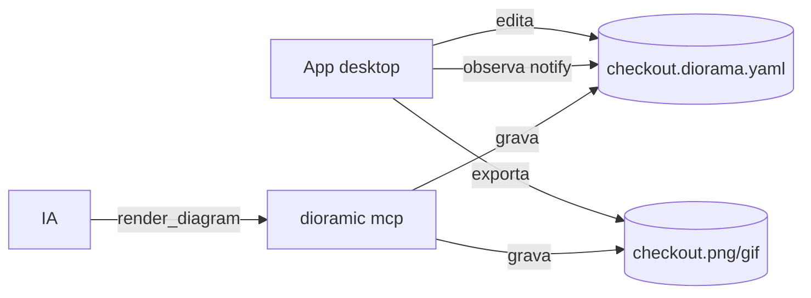

# 08 — App desktop (100% Rust)

## Papel do app

O produto principal é o **MCP**. O app desktop resolve o que a IA sozinha não resolve bem:

1. **Ver ao vivo** o que a IA está desenhando (o app observa os `.diorama.yaml`).
2. **Ajuste fino** visual: arrastar um nó, editar um label, trocar um ícone.
3. **Exportar** com controle (tema, tamanho, formato, preset de animação) e tocar animações.

## Stack: Tauri 2

| Opção | Prós | Contras | Veredito |
|---|---|---|---|
| **Tauri 2** + webview | O webview **exibe o SVG nativamente** (zoom nítido, CSS de animação funcionando de graça); binário pequeno (WKWebView no macOS); empacotamento, updater e menus maduros; backend Rust usa os crates do workspace direto | UI roda num webview | ✅ **Recomendado** |
| Dioxus 0.7 (desktop) | 100% Rust estilo React; também usa webview | Ecossistema de empacotamento menos maduro que o do Tauri | Alternativa viável |
| egui / iced (nativo) | Rust puro, sem webview | Preview teria que rasterizar via `resvg` a cada zoom; animação CSS não funcionaria; editor isométrico desenhado do zero | ❌ Para este caso |

### Frontend dentro do Tauri

- **Decisão: Leptos (CSR, WASM), 100% Rust** ([ADR-011](02-decisoes.md#adr-011)).
- **Na v1 o core não roda no frontend.** `apps/desktop` é um workspace Cargo separado (o raiz exclui `apps/`) com três crates:
  `ipc` (DTOs serde, sem engine), `src-tauri` (backend: comandos Tauri finos sobre `dioramic_render::Engine`) e `ui` (Leptos, via `trunk`).
  A UI pede o preview por comando e recebe **SVG** (texto como `<text>`, com a Inter carregada por `@font-face`).
  Levar o `dioramic-core` em WASM ao frontend fica para o modo editor (arrastar nós sem ida e volta).
- Descartado: TypeScript (Svelte/Solid) na UI. A UI sairia mais rápido, mas o projeto quer ser 100% Rust.
- Ícone do app: [brand/icon/dioramic-icon-1024.png](../brand/icon/dioramic-icon-1024.png) (ver [10-marca.md](10-marca.md)).

## Relação com o MCP

- **O arquivo é o contrato** ([ADR-004](02-decisoes.md#adr-004)). Os processos não se conhecem, então qualquer um funciona sem o outro.
- O MCP grava o spec mesmo quando recebe inline (`save_spec: true`), e o app pega a mudança na hora.
- Deep link `dioramic://open?path=…` para a futura tool `open_in_app` (não implementado).
- Futuro (v2): o app expõe um MCP HTTP local com `get_selection`, para a IA saber **o que você selecionou**
  ("deixa esse nó vermelho e anima esse caminho").

## Funcionalidades por fase

| Fase | Funcionalidades |
|---|---|
| **Viewer** (v1, feito) | Abrir pasta, listar `*.diorama.yaml`, preview ao vivo, zoom/pan, troca de tema, **girar a câmera** (⟲ ⟳ e "auto"), **alternar espaçado/compacto**, **curvas/trilhos**, **malha de fundo**, painel de diagnósticos (clicar destaca o elemento), tocar animação, exportar |
| **Editor** | Arrastar nós com snap de meio tile (grava `at`), editar labels inline, seletor de ícones (busca + folha de contato), redimensionar zonas, desfazer/refazer |
| **Colaboração com IA** | Diff animado quando a IA muda o spec (nós novos "caem" no lugar), `get_selection`, histórico de versões do spec |

## Pontos técnicos

- **Hit-testing:** cada elemento do SVG leva `data-id` e `data-role`. O clique seleciona pelo DOM, sem geometria manual.
- **Arrastar no plano:** para converter tela em plano, aplicar a inversa da projeção (com `Y' = Y + z·T`):
  `x = (X/(cos30·T) + Y'/(sin30·T)) / 2` e `y = (Y'/(sin30·T) − X/(cos30·T)) / 2`. Depois, snap para meio tile.
- **Fidelidade:** o preview no webview e o PNG do `resvg` podem divergir em detalhes (anti-alias, fontes).
  Mitigação: a mesma Inter embutida via `@font-face` (feito); um modo "preview raster" com `resvg` fica para depois.
- **Edição sem destruir o YAML:** reserializar o spec perderia comentários e formatação.
  Fazer **edições cirúrgicas por posição no texto** só no campo alterado. É o principal risco técnico do editor; o Fixar já faz isso para a vista (acima).

## O que existe na v1 (T-203, T-33x, T-360, T-391, T-405)

**Idioma da UI: inglês**, como o resto do produto (código, CLI, MCP). Esta documentação segue em pt-BR.

**Três painéis**, com divisores arrastáveis e painéis recolhíveis (proporção inicial editor:preview 40:60):

| Painel | Conteúdo |
|---|---|
| Árvore de arquivos | `*.diorama.{yaml,yml,json}` da pasta (só o *stem*, reticência no meio), observada com `notify` |
| Editor | Textarea sobre realce próprio de YAML; gutter, linha ativa, lentes de diagnóstico na linha, Enter/Tab preservando indentação e o *undo* nativo; *soft wrap* opcional |
| Preview | SVG do engine sobre uma grade isométrica que acompanha zoom/pan (pinça, ⌘-roda, arrastar, dois dedos); folha do diagrama com sombra; tooltip de `note`; painel de problemas embaixo (clique seleciona a linha e destaca `[data-id]` no SVG) |

Em volta: barra de título (marca, breadcrumb relativo, resumo de problemas, claro/escuro/sistema), barra de status, toasts,
tela de boas-vindas e estados vazios ("warming up", spec com erro mostrando o último render válido esmaecido).

**Ao vivo:** debounce de 150 ms, respostas fora de ordem descartadas, render em `spawn_blocking`. Se a IA grava o arquivo aberto e não há
edição local, o editor recarrega (toast "updated on disk"); com edição local, um banner oferece "carregar do disco / manter a minha".
Ao trocar de arquivo com edição pendente, o app salva antes.

### Ícones de provedores e do projeto (T-391)

O app usa os mesmos ícones que o CLI: os **packs instalados** (`$XDG_DATA_HOME/dioramic/icons`, senão `~/.local/share/dioramic/icons`,
instalados com `dioramic icons install <aws|gcp|azure|k8s>`) mais a pasta **`icons/` ao lado do spec aberto** (`icon: local/<nome>`).

- **Preview e export** preenchem `RenderRequest.icons` com esse registro (`src-tauri/src/icons.rs`, `IconLibrary` sobre o
  `dioramic_packs::PackStore`). Para saber de que pasta ler `icons/`, o `PreviewRequest` do `ipc` ganhou `spec_path: Option<String>`
  (`#[serde(default)]`, enviado pela UI ao abrir o arquivo); o export já levava o `spec_path`. Spec não salvo: só os packs instalados.
- **Cache barato:** antes de todo render o app tira um *fingerprint* da store e de `icons/` (lista a pasta e lê nome, tamanho e mtime, sem
  parse). Só relê os manifests e SVGs quando o fingerprint muda; trocar de arquivo dentro da mesma pasta reaproveita o registro.
- **Recarga sem reiniciar:** uma thread vigia a store a cada 2 s (um *watch* não pegaria a criação da store no primeiro `icons install`) e
  o watcher do workspace marca mudanças em qualquer pasta `icons/`. Os dois emitem o evento **`icons-changed`** (`IconsChanged { path }`),
  e a UI só reagenda o preview. Instalar um pack com o app aberto troca os ícones em até ~2 s.
- **Painel de problemas:** pack citado e não instalado chega como **`W_ICON_PACK_MISSING`** (aviso, com o nó destacado) e o diagrama
  desenha o ícone embutido mais próximo. A dica é reescrita para o app: "Run `dioramic icons install aws` in a terminal; the preview
  updates once the pack is installed." (o comando em fonte de código; some o "then render again" do CLI). Um SVG de ícone ilegível vira o
  aviso só do app **`W_ICON_LOAD`** com o caminho, e o resto do registro continua valendo.
- Não há UI para instalar packs na v1: a dica aponta o CLI.

### Barra flutuante e atalhos

Inspirada na barra flutuante da referência (que tem ⟲ ⟳ e câmera). Atalhos de uma tecla só valem fora do editor.

| Controle | Atalho | Ação |
|---|---|---|
| ⟲ / ⟳ | `[` / `]` | Gira a câmera 90° (anti-horário / horário) |
| Auto | `A` | `rotation: auto` (o readout mostra o ângulo escolhido) |
| Spaced / Compact | `D` | Alterna `layout.density` |
| Flow / Hub (Layout) | `L` | Alterna `layout.algorithm` entre `flow` (zonas na ordem do fluxo) e `hub` (nós mais conectados no centro, arestas curtas); sem override mostra o que o spec/tema usa (`hub` no `schematic`) |
| Curves / Rails (Conexões) | `R` | Alterna `layout.routing` entre `curved` e `rails` (spec com `orthogonal`/`straight` mostra isso no tooltip e vai para `rails`) |
| Grid (Malha) | `G` | Popover da malha: estilo (linhas, pontos, nenhuma), célula (½, 1, 2 tiles + slider fino logarítmico de 0,25 a 4), opacidade, prévia isométrica e "Reset" (volta ao spec) |
| Motion (Movimento) | `M` | Prévia animada: pacotes e ícones em movimento (SVG animado) |
| Tema | — | Menu com amostras isométricas dos 4 temas |
| Pin (Fixar) | — | Grava a vista atual no spec |
| Export | `⌘E` | Popover de export |
| Enquadrar | `0` ou duplo clique | Reenquadra o diagrama |
| — | `⌘S` / `⌘O` | Salvar / abrir pasta |
| — | `⌘B` / `⌘\` / `⌥Z` | Recolher árvore / recolher editor / *soft wrap* |

A rotação, a densidade, o tema, o layout, as conexões e a malha são **estado da vista** (por arquivo: abrir outro spec volta ao que ele diz) até o
usuário clicar em **Fixar**, para não sujar o diff a cada clique. O tooltip do Fixar lista o que será gravado.
O Fixar edita só `view.rotation`, `layout.density`, `theme`, `layout.algorithm`, `layout.routing` e `view.grid`. A malha é mesclada sobre a `view.grid` que o spec
já tem (a `color` fica; um campo ainda no padrão só é escrito se o spec já o cita; uma malha padrão sobre spec sem `view.grid` não grava nada);
no YAML sai como flow map numa linha (`grid: { size: 0.5, style: dots }`, substituindo um bloco aninhado sem comentários), no JSON a edição é
chave a chave dentro do objeto existente. No YAML, edição por linha preservando comentários, flow maps (um flow map
multilinha é dobrado numa linha), âncoras e CRLF; no JSON, pelo CST do `jsonc-parser`. Toda edição passa por uma verificação semântica
(o documento reparseado tem que ser o original com só esses valores trocados); layouts que não dá para editar com segurança são **recusados**
com erro em toast e o texto fica intacto.

### Conexões, malha e movimento (T-405)

- **Engine:** a UI manda `ViewState.routing` e `ViewState.grid` (`ipc`); o backend os passa como `RenderRequest.routing`/`grid` (C-006), que o
  engine escreve no spec antes de normalizar, então a prévia é exatamente o que o Fixar gravaria. `ResolvedView` devolve `routing` e `grid`
  usados, para os controles mostrarem o estado do spec quando não há override.
- **Movimento:** `PreviewRequest.motion` pede `svg-animated` (texto como `<text>`) em vez do SVG estático; o webview toca o CSS/SMIL. É uma
  preferência do app (`localStorage`, vale para todos os arquivos), não vai para o spec nem para o export. Com "reduzir movimento" do sistema
  (`prefers-reduced-motion`, observado ao vivo) o botão fica desabilitado e a prévia volta a ser estática, porque o SMIL não obedece CSS.
- **Barra:** com os três controles novos, os rótulos dos botões somem abaixo de ~1080 px de prévia (container query) e o "Export" abaixo de
  700 px; só ícones, com tooltips e atalhos. Capturas em `docs/work/reviews/img/desktop-v3-*.png`.

### Layout Flow/Hub (T-413)

- `ViewState.layout` / `ResolvedView.layout` (`ViewLayout { Flow, Hub }`, `ipc`) → `RenderRequest.layout_algorithm` (C-006). O tema
  `schematic` já usa `hub` quando o spec não escreve `layout.algorithm`, e o controle mostra isso pelo `ResolvedView`.
- **Fixar** grava `layout.algorithm` (YAML no flow map/bloco de `layout:`, JSON chave a chave), com a mesma verificação semântica.
- Barra: o segmento **Flow / Hub** fica entre a densidade e as conexões; os rótulos somem abaixo de ~1200 px de prévia (antes 1080).
  O resumo do Export mostra "· hub" quando o layout é `hub`.

### Export

Popover com formato **PNG, SVG ou GIF**, densidade de pixel, progresso (indeterminado no GIF) e cancelar; diálogo nativo de salvar;
toast "Exported x.gif · N KB" com "Show". O engine não tem cancelamento: cancelar descarta o resultado.

### Fora da v1

Preview raster (`resvg`) alternativo, deep link, modo editor (arrastar nós, seletor de ícones, `get_selection`) e destaque de arestas
a partir do painel de problemas (hoje só `nodes[i]`/`zones[i]`).

Rodar: `cd apps/desktop && DIORAMIC_WORKSPACE=$PWD/../../examples cargo tauri dev`; só a UI no navegador, com backend de demonstração:
`cd apps/desktop/ui && trunk serve`.
