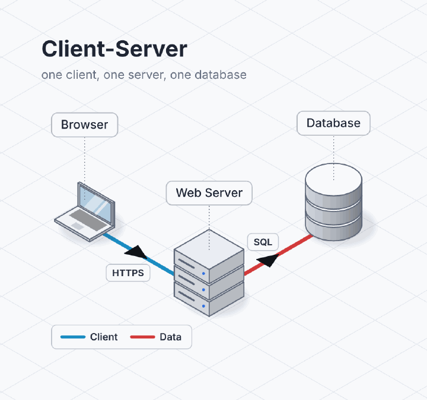
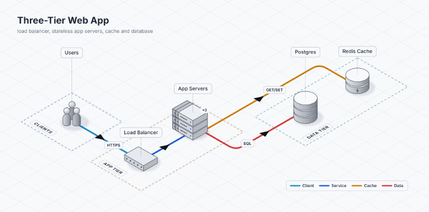
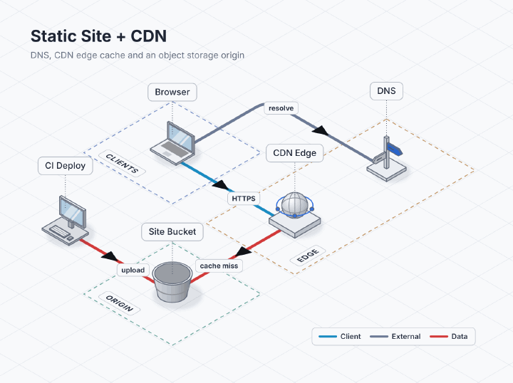
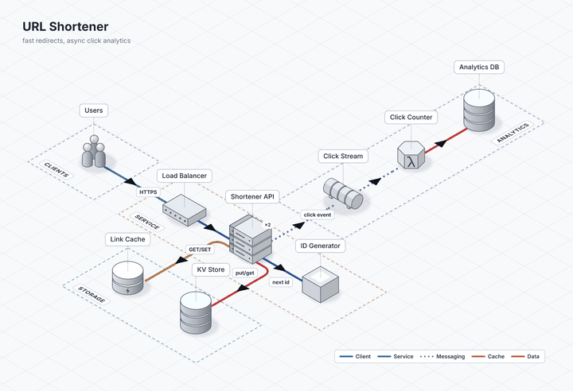
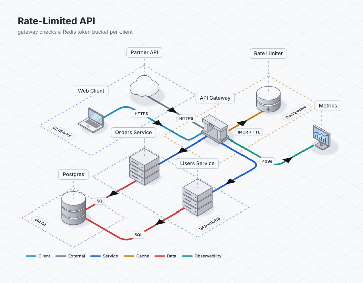
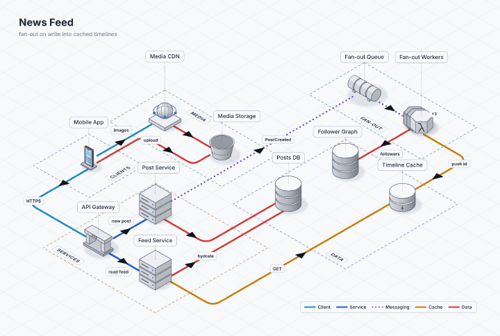
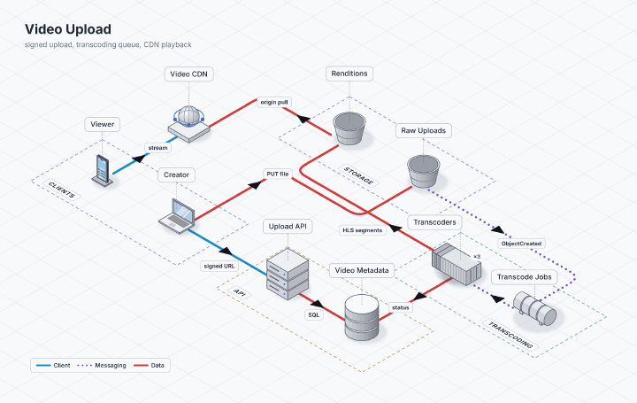
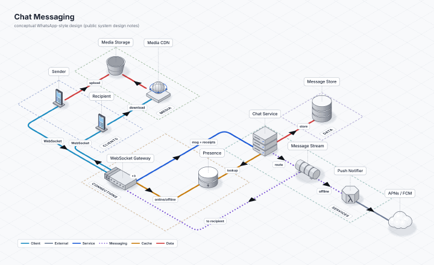
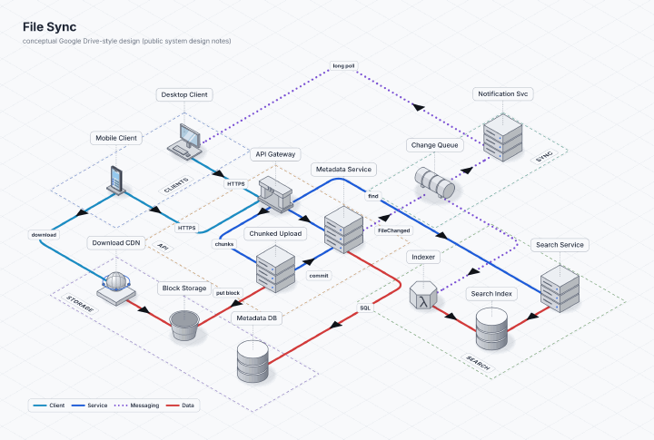
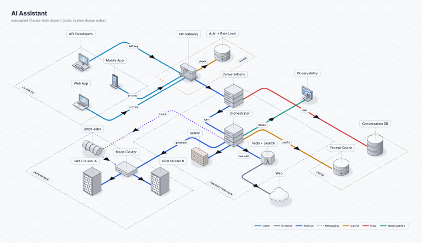

# Galeria de system designs (tema `schematic`)

Dez specs em ordem de complexidade, do cliente-servidor ao assistente de IA. Todos usam o tema `schematic` como sai da caixa:
layout `hub`, trilhos (`rails`), ponta preta no meio da aresta, **cores pela classe da conexão** (client, external, service,
messaging, cache, data, observability) e legenda automática. Nenhum spec tem `at`, `size`, `rotation`, `wrap` nem cor; as dicas que
existem estão comentadas (`arrange: row` no 05, `@external` no 03).

```bash
dioramic render examples/schematic/04-url-shortener.diorama.yaml -o url-shortener.png
dioramic render examples/schematic/04-url-shortener.diorama.yaml -o url-shortener.gif   # os que têm animation: flow
```

> Os três últimos (08–10) são **arquiteturas conceituais** montadas a partir de discussões públicas de system design, não o desenho
> interno de nenhuma empresa. Não usam logos nem afirmam detalhes de implementação dos produtos citados.

| # | Diagrama | O que ensina |
|---|---|---|
| 01 | [Client-Server](01-client-server.diorama.yaml)<br> | O mínimo: 3 nós, 2 arestas, nenhuma zona. Cada aresta já sai com a cor da classe inferida (`client`, `data`) e a legenda aparece sozinha |
| 02 | [Three-Tier Web App](02-three-tier.diorama.yaml)<br> | Zonas como camadas; `replicas: 3` para um tier escalado na horizontal (um nó, não um por servidor, que dobraria as arestas); `cache` e `data` lado a lado |
| 03 | [Static Site + CDN](03-static-site-cdn.diorama.yaml)<br> | Forçar a classe com `@external` (a consulta ao DNS não é tráfego da aplicação); um nó fora de zona (CI) que escreve no mesmo bucket que a CDN lê |
| 04 | [URL Shortener](04-url-shortener.diorama.yaml)<br> | Mensageria fora do caminho quente: `..>` vira pontilhado `messaging`, e tudo que sai da fila herda a classe; `animation: { preset: flow }` |
| 05 | [Rate-Limited API](05-rate-limiter.diorama.yaml)<br> | Um gateway como hub; o limitador como `cache`; parceiro externo (`cloud` → `external`); `observability` para métricas. `arrange: row` na zona de serviços evita que o leque do gateway cruze as arestas de dados |
| 06 | [News Feed](06-news-feed.diorama.yaml)<br> | Caminhos de escrita e de leitura separados; a fila desacopla o fan-out; o cache **é** o modelo de leitura; mídia numa zona própria |
| 07 | [Video Upload](07-video-upload.diorama.yaml)<br> | Um pipeline assíncrono longo (upload → evento → fila → workers → storage → CDN); a aresta segue o sentido do dado (`renditions -> cdn: origin pull`) |
| 08 | [Chat Messaging](08-chat-like-whatsapp.diorama.yaml)<br> | Conceitual, estilo WhatsApp. Camada de conexões com estado (gateway WebSocket ×3), presença em cache, stream que entrega online ou acorda o push; recibos sobem pelo mesmo canal |
| 09 | [File Sync](09-file-sync-like-google-drive.diorama.yaml)<br> | Conceitual, estilo Google Drive. Metadados separados dos blocos; a fila de mudanças faz fan-out para notificação (long poll) e indexação; busca numa zona própria |
| 10 | [AI Assistant](10-ai-assistant-like-claude.diorama.yaml)<br> | Conceitual, estilo Claude. Um orquestrador com seis classes de conexão ao mesmo tempo e a espinha clientes → gateway → orquestração → GPUs ainda legível |

Mosaico com os dez: [docs/assets/galeria-schematic.png](../../docs/assets/galeria-schematic.png).

## Régua usada

Cada spec foi renderizado com o binário e conferido com recortes ampliados até passar:

- em ≤ 5 s dá para dizer a que cada peça se conecta e em que direção; a espinha do fluxo aparece de relance;
- 0 cruzamentos entre arestas do mesmo nó; `dioramic lint` sem `W_LABEL_OVERLAP` na vista padrão;
- labels ≤ 24 caracteres, subtítulo de uma linha.

Quando o layout não lia bem, o spec foi **simplificado** (menos arestas redundantes, zonas que agrupam o que conversa) antes de
qualquer dica de posição.
